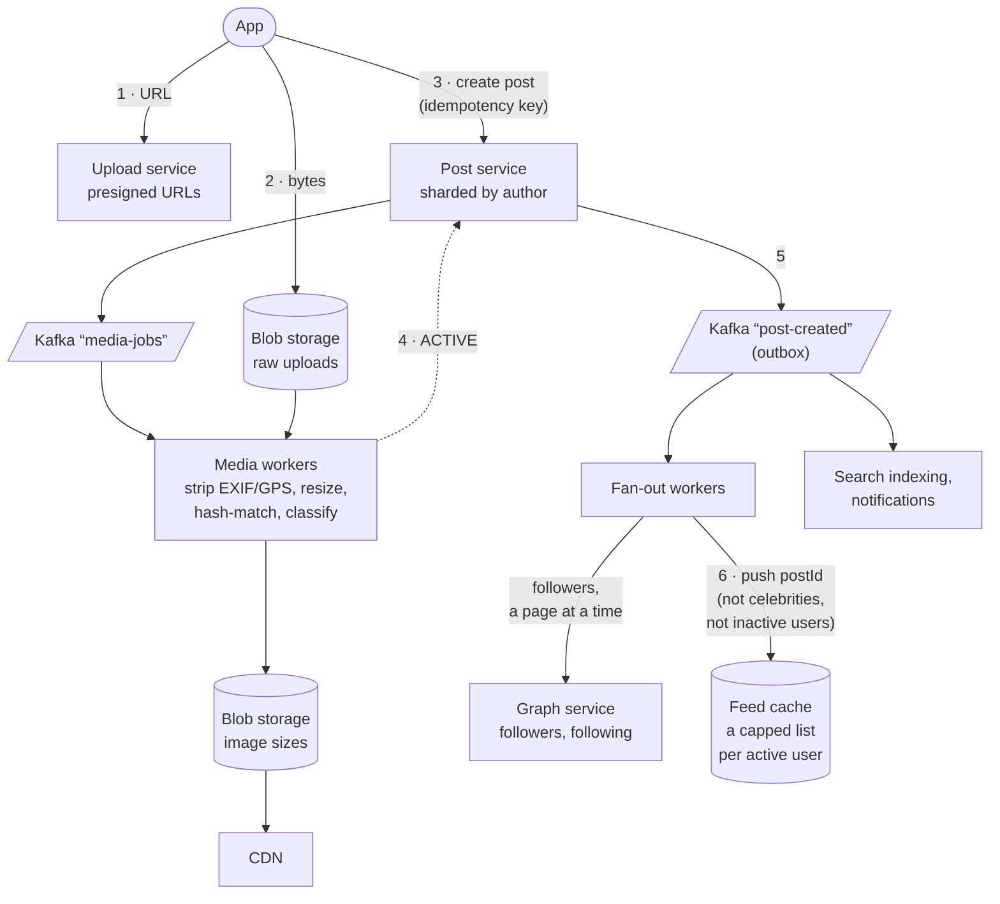
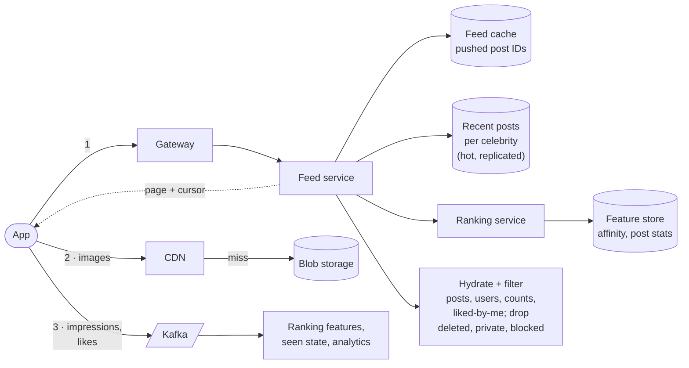

# Social Media: Photo Sharing & the Home Feed (Instagram)

**The prompt:** "Design Instagram — people post photos and videos, follow each other, and scroll a home feed of posts from the accounts they follow, with likes, comments and notifications." It's the classic fan-out question, and a candidate reported it from a Disney+ Hotstar SDE-2 loop (before the JioStar merger), where one round tends to want the HLD, the LLD and the schema together. What it tests: a write path and a read path with very different shapes; **fan-out on write vs fan-out on read**, and the hybrid that solves **the celebrity problem**; an upload pipeline for billions of small files; counters on hot keys; ranking inside a latency budget; and knowing what may be eventually consistent (feeds, counts) and what may not (privacy, blocks, deletes). Related: [33 · media ingest](33_Media_Ingest_Transcoding.md) (the same upload → transform → publish shape), [21 · fantasy sports](21_Fantasy_Sports.md) (one event fanned out to millions), [18 · traffic spikes](18_Premiere_Traffic_Spike.md) (herds and hot keys).

## Clarify first

**What Instagram does today:** 3B monthly active users (Sept 2025); photos stored at most 1,080 px wide; a ranked home feed since 2016, with chronological **Following** and **Favorites** views since 2022.

**Functional**

- Post a photo or a carousel with a caption, tags and a location; short videos too ([note 33](33_Media_Ingest_Transcoding.md) covers transcoding).
- Follow and unfollow; **private accounts** approve follow requests; block.
- **Home feed:** posts from the accounts you follow, ranked, infinite scroll — plus a chronological view.
- Like, comment and save, with counts; a profile grid with follower counts; notifications ("alice liked your photo").
- Stories (gone after 24 h) — the usual follow-up; deep dive 8.

**Non-functional — say numbers**

- Scale: design for **500M daily actives** and **~100M new posts a day** — about 50 feed loads for every post.
- The first feed page at p50 ≈ 100 ms, **p99 ≤ 300 ms** server-side; "Share" feels instant.
- A post reaches followers' feeds **within seconds** (a minute is fine for the biggest accounts).
- Feeds and counts may be stale — but **your own post shows to you at once**, and privacy, blocks and deletes are never eventually consistent: they're checked on every read.
- An acknowledged photo is never lost; the feed degrades (stale, unranked) rather than failing.

**Say what's out of scope:** Direct messages (tracker #22), search and Explore ([note 27](27_Search_Autocomplete.md)), Reels recommendations ([note 26](26_Home_Page_Recommendations.md)), ads (#37), delivering notifications (#4).

## Back-of-envelope

- **Posts:** 100M/day ÷ 86,400 s ≈ **1,200 posts/s**, ~3–5K/s at peak.
- **Feed loads:** 500M × ~10 a day = 5B ≈ **60K/s** (~150K/s at peak), each hydrating ~12 posts → **1–2M post lookups/s**: caches, not databases.
- **Likes:** ~5–10B a day ≈ **60–120K/s**, bunched on popular posts.
- **Fan-out on write:** 100M posts × ~300 active followers ≈ **30B feed inserts a day ≈ 350K/s** — fine on average. The tail is the problem: one post from a 650M-follower account is 650M inserts, **~11 minutes at 1M/s**, mostly into feeds nobody opens before the next post.
- **Feed cache:** ~500 entries × ~16 bytes (post ID + author ID, packed) ≈ 8 KB per active user → **4 TB**, 12 TB with three replicas. A Redis sorted set spends ~100 bytes per entry, so at full scale feeds are capped, packed and kept only for active users.
- **Media:** ~4–6 sizes per photo, ~2 MB per post → **200 TB a day, ~70 PB a year** before replication. Feed photos alone are ~**0.5 Tbps** of egress (5B loads × 12 images × ~100 KB); video is many times that — CDNs again ([note 17](17_Disney_Plus_Video_Streaming.md)).
- **Graph:** 3B users × ~200 follows ≈ **600B edges**, stored in both directions.

## API

```text
POST   /v1/uploads                    { contentType, sizeBytes, sha256 }
                                      → { uploadId, url (presigned, resumable) }
PUT    {url}                          the bytes, straight to blob storage

POST   /v1/posts                      { uploadIds[], caption, location?, userTags? }
       Idempotency-Key: <uuid>        → 202 { postId, status: PROCESSING }
DELETE /v1/posts/{id}

GET    /v1/feed?cursor=…&limit=12     → { items: [ { post, author, media[],
                                            likeCount, likedByMe } ], nextCursor }
GET    /v1/feed/following?cursor=…    chronological
GET    /v1/users/{id}/posts?cursor=…  the profile grid

PUT    /v1/users/{id}/follow          → { state: FOLLOWING | REQUESTED }
PUT    /v1/posts/{id}/like            liking twice is still one like
DELETE /v1/posts/{id}/like
POST   /v1/posts/{id}/comments        { text, replyTo? }
```

- **The bytes never touch the API servers:** presigned URLs, straight to blob storage.
- **PUT for likes and follows** names the end state, so a retry is harmless ([07_Spring_MVC_REST_API.md](../Java_SpringBoot/07_Spring_MVC_REST_API.md)); `POST /posts` takes an idempotency key, so a flaky connection can't post the photo twice.
- **Cursors, not offsets:** new posts arrive at the top while you scroll, so offsets repeat or skip posts, and deep offsets are slow ([15_SQL_Query_Practice.md](../Java_SpringBoot/15_SQL_Query_Practice.md)). Items come hydrated — post, author, counts, "liked by me", a CDN URL per size — so a page is one round trip.

## Data model

| Entity | Key fields | Store |
|---|---|---|
| User | userId, handle, bio, avatar, isPrivate | Sharded relational (Instagram ran sharded Postgres) + cache |
| Post | postId (64-bit, time-sortable), authorId, caption, media[], createdAt, status | Sharded by **authorId** — a profile grid is one range scan on one shard |
| Media | mediaId, postId, width, height, sizes {px → path}, blurhash | With the post; the bytes in blob storage |
| Follow | (followerId, followeeId, state, createdAt), stored **twice**: by follower and by followee | Graph store (TAO-style) or wide-column |
| Feed | userId → [(postId, authorId, createdAt)], capped at ~500 | In memory (Redis) — **derived, rebuildable** |
| Like | PK (userId, postId); a copy by (postId, time bucket) for "liked by" lists | Wide-column (Cassandra) |
| Counter | (objectId, kind) → n | Updated asynchronously, in batches |
| Comment | (postId, bucket, commentId), authorId, text, parentId | Wide-column |
| Notification | (userId, notificationId), type, actorIds, objectId, seen | Wide-column, with a TTL |

- **The post ID carries the time and the shard** — Instagram's 41 + 13 + 10 bits (LLD): IDs sort by creation time across shards, and any ID names its shard.
- **Shard by user, through logical shards:** Instagram mapped thousands of logical shards (Postgres schemas) onto far fewer servers, so moving one needs no re-bucketing. A user's profile, posts and outgoing edges live together.
- **Edges are stored twice** — "who do I follow" builds feeds, "who follows me" drives fan-out — on different shards: write one, publish an event, write the other idempotently, and reconcile drift.
- **The feed is a cache, not a source of truth:** losing a cache node slows some first loads and loses nothing.
- **Likes are partitioned by the liker,** so a viral post's million likes spread over a million partitions. Instagram began replacing Redis with Cassandra in 2012 and runs Feed and the Direct inbox on it — write-heavy data read by one key.

## Architecture

**Posting — from "Share" to followers' feeds**



**Reading the feed**



**From "Share" to a follower's screen**

1. The app starts uploading the moment a photo is picked — while the user is still choosing a filter and typing the caption — so "Share" sends only text (an early Instagram trick co-founder Mike Krieger has talked about).
2. `POST /posts` saves the post (PROCESSING) and an outbox row for its media job in one transaction → `202`; the author's app already shows the post locally.
3. Media workers re-encode, strip EXIF, make the sizes, hash-match and mark it ACTIVE; `PostCreated` goes out, and fan-out pushes the ID into each active follower's feed — unless the author is a celebrity.
4. A follower opens the app: pushed IDs + pulled celebrity posts → rank → hydrate and filter → a page, images from the CDN.

## Deep dives

### 1. Fan-out on write, fan-out on read — and the hybrid

- **Push (fan-out on write):** when a post goes live, insert its ID into every follower's feed. A read is one cache read; a write is one insert per follower — wasted on followers who never open the app, and minutes long for big accounts.
- **Pull (fan-out on read):** store nothing per viewer; on each load, fetch the recent posts of everyone the viewer follows and merge. No write amplification and always fresh — but following 1,000 accounts means 1,000 lookups per load, 60K loads a second.
- **The hybrid:** push for ordinary accounts, **pull for accounts above a follower threshold** (say 100K), merge at read time. A viewer follows a few dozen celebrities at most, and each celebrity's latest posts are one hot cache entry shared by millions of readers. Push only to followers active in the last ~30 days; anyone else gets a feed rebuilt by pulling when they return.

| | Push | Pull | Hybrid |
|---|---|---|---|
| Work per post | One insert per follower | One insert | One insert per *active, ordinary* follower |
| Work per feed load | One list read | One lookup per followee, then a merge | One list read + a few dozen hot lookups |
| A 650M-follower post | ~11 minutes of fan-out | Free | Free — it's pulled |
| Freshness | Once fan-out finishes | Instant | Instant for celebrities, seconds for others |

- **Twitter, 2013:** Redis timelines capped at 800 entries; ~300K reads/s against ~6K writes/s; a Lady Gaga tweet took up to 5 minutes to reach her 31M followers — so the biggest accounts were merged in at read time instead.
- **The threshold is a cost knob** — followers × posting rate, not followers alone — and crossing it is seamless, because the merge dedupes by post ID.

### 2. The upload pipeline

- **Do the work on the phone, early:** resize to 1,080 px, compress, and upload as soon as the photo is picked. Uploads are resumable and go straight to blob storage ([note 33](33_Media_Ingest_Transcoding.md) on why never through API servers).
- **Never trust the file:** decode and re-encode it — only the pixels survive, so anything smuggled inside is gone — and **strip EXIF**: phone photos often carry the GPS position of someone's home.
- **Sizes:** 1080, 640 and 320 px plus a thumbnail, in WebP or AVIF with a JPEG fallback, and a **blurhash** — a ~30-character placeholder the app paints while the image loads. Paths are content-addressed, so a URL never changes and caches forever.
- **Before going live:** perceptual hashes (Facebook open-sourced PDQ in 2019) are matched against known abuse material; slower classifiers run afterwards and can take a post down. Only ACTIVE posts are fanned out. Video follows [note 33](33_Media_Ingest_Transcoding.md), with a quick low-resolution rendition first so the post is live in seconds.

### 3. Storing and serving billions of photos

- **Not one file per photo:** directory and inode lookups cost disk reads before the photo itself. Facebook's **Haystack** (2010) packed photos into large append-only volumes with an in-memory index — usually one disk read per photo. Object stores do the same for you.
- **Hot, then warm:** views concentrate in a photo's first days, so older photos move to erasure-coded storage — Facebook's **f4** (2014) cut the effective replication factor from 3.6 to 2.8 or 2.1. At ~70 PB a year, that's tens of petabytes.
- **The CDN serves:** immutable URLs, long lifetimes, the size the screen needs. **Private accounts** get signed URLs that expire in hours, issued only to approved followers.
- **Deletes:** mark the post DELETED — gone from every response at once — delete the blobs, and purge the CDN for legal takedowns.

### 4. The social graph

- **TAO**, Facebook's graph store, is the model: objects (users, posts) and typed associations (follows, likes) kept as time-ordered lists, behind a graph-aware cache over sharded MySQL — a billion reads and millions of writes a second.
- **Huge follower lists** (650M+ entries) are only ever read in pages — and celebrities aren't fanned out at all.
- **Follow:** write the edge, publish `Followed`, write the reverse edge and the counts from the event, and **backfill** a few recent posts so the follow shows something at once. **Unfollow:** filter on read and let old entries age out — never scan the feed.
- **Private accounts and blocks:** posts are pushed only to approved followers; removing a follower or blocking someone takes effect through the read-time filter (deep dive 7), against the follow state and a cached per-user block set.

### 5. Ranking the feed

- **What Instagram says it weighs:** the post (popularity, how fast it's gathering engagement, when it was posted), the poster (how interesting they've been to you), your activity, and your history with the poster.
- **Stages, cheap to expensive:** ~500–1,000 candidates → a light model keeps a few hundred → a heavy model predicts P(like), P(comment), P(share), P(save) and time spent → a weighted score → rules (no three posts from one account in a row, seen posts sink). Facebook's News Feed runs the same three passes.
- **Inside ~100 ms:** affinity and author features are precomputed into a feature store; only a few (last-hour engagement) are computed live.
- **Rank once per session:** the ranked list is cached and the cursor points into it, so page 2 continues page 1; pull-to-refresh starts a new session. Once everything new from the last two days has been seen, the feed says **"You're all caught up"**.
- **Fallback:** ranker slow or down → newest first. The chronological views skip the heavy ranker entirely.

### 6. Likes and hot counters

- **A like is a row** keyed (userId, postId): liking twice writes the same row, so the likers are exact and the API is idempotent.
- **The count is the hot key:** a celebrity's post can take thousands of likes a second. Each like publishes a +1 keyed by postId; the consumer that owns the partition sums a second or two of them and writes **one increment per post per batch**. Without a stream, shard the counter: N rows, increment a random one, sum on read.
- **Disney+ Hotstar did this for live emoji reactions during cricket:** 5B emojis from 55.8M users at the 2019 World Cup, aggregated in 2-second batches (Kafka → Spark) and fanned out as one summary.
- **Counts are approximate** ("1.2M"), cached for seconds and recounted in the background. Comments are partitioned by post and time bucket; notifications coalesce — "alice and 1,203 others liked your photo" is one notification updated in place.

### 7. Read-your-writes, and filtering on read

- **Your own post, at once:** the feed service merges the viewer's posts from the last few minutes, read from their shard's primary — fan-out and replicas may lag.
- **Filter on read:** feeds hold only IDs, and hydration drops anything deleted, hidden, unfollowed, private or blocked. Rewriting 10M feeds after a delete would be slow and could still race; one status check per post is cheap and always right. If filtering shorts a page, read further down the list (LLD).

### 8. Stories — what changes

- Stories appear as a **tray of accounts** with something from the last 24 hours, so the unit is the author: push *the account* into each follower's tray, scored by its latest story — ten stories in a row update one entry. Celebrities are pulled, as in the feed. On read: drop anything older than 24 h, rank by affinity, unseen first.
- **Expiry is a TTL** on the media and metadata; saving to a highlight copies the story to permanent storage.
- **Viewer lists are write-heavy:** one `(storyId, viewerId)` row per view, partitioned by story and expiring with it.

## LLD

Post IDs, Instagram-style — 64 bits, sortable by time, unique across shards without coordination:

```java
/** 41 bits of ms since EPOCH | 13 bits of logical shard | 10 bits of sequence. */
public final class PostIds {
    private static final long EPOCH_MS = 1_704_067_200_000L;           // 2024-01-01T00:00:00Z
    private static final int SHARD_BITS = 13, SEQ_BITS = 10;
    private static final long SEQ_MASK = (1L << SEQ_BITS) - 1;         // 1,024 ids per ms per shard

    private final long shard;                                          // this database's logical shard, 0–8,191
    private final Clock clock;
    private long lastMs = -1, seq;

    public PostIds(long shard, Clock clock) { this.shard = shard; this.clock = clock; }

    public synchronized long next() {
        long now = Math.max(clock.millis(), lastMs);                   // the clock stepped back: stay on lastMs
        if (now == lastMs) {
            seq = (seq + 1) & SEQ_MASK;
            if (seq == 0) now = waitPast(lastMs);                      // 1,024 ids this ms: use the next ms
        } else {
            seq = 0;
        }
        lastMs = now;
        return ((now - EPOCH_MS) << (SHARD_BITS + SEQ_BITS)) | (shard << SEQ_BITS) | seq;
    }

    private long waitPast(long ms) {
        long now;
        while ((now = clock.millis()) <= ms) Thread.onSpinWait();
        return now;
    }

    public static long shardOf(long id)   { return (id >>> SEQ_BITS) & ((1L << SHARD_BITS) - 1); }
    public static Instant timeOf(long id) { return Instant.ofEpochMilli((id >>> (SHARD_BITS + SEQ_BITS)) + EPOCH_MS); }
}
```

The shard bits keep IDs unique across shards, the sequence within a millisecond (Instagram generated them in a PL/pgSQL function in each logical shard), and a clock stepped back by NTP never mints an ID twice. One catch: the top time bit is also the sign bit of a `long` or a Postgres `bigint`, so the IDs go negative ~35 years (2^40 ms) after the epoch — Snowflake leaves that bit unused.

Pushing into a feed — atomic, idempotent, and only into feeds that exist:

```lua
-- KEYS[1] = feed:{userId}   sorted set: member = postId, score = createdAt in ms
-- ARGV[1] = createdAtMs, ARGV[2] = postId, ARGV[3] = cap
if redis.call('EXISTS', KEYS[1]) == 0 then return 0 end                -- no feed (inactive, evicted): rebuilt on read
redis.call('ZADD', KEYS[1], ARGV[1], ARGV[2])                          -- a retry re-adds the same member: no change
redis.call('ZREMRANGEBYRANK', KEYS[1], 0, -(tonumber(ARGV[3]) + 1))    -- keep only the newest `cap`
return 1
```

An expired or evicted feed isn't there, so pushes never half-build it; the next read rebuilds it whole. The score is the timestamp, not the ID — Redis scores are doubles, exact only up to 2^53.

The fan-out worker — the push half of the hybrid:

```java
@Component
public class FanoutWorker {
    private static final long PULL_ABOVE = 100_000;          // followers; bigger accounts are pulled at read time
    private static final int PAGE = 1_000;

    private final GraphClient graph;
    private final ActivityIndex activity;                    // when each user last opened the app
    private final FeedStore feeds;                           // runs the script above, pipelined per page

    @KafkaListener(topics = "post-created", groupId = "fanout")
    public void onPostCreated(PostCreated e) {
        if (graph.followerCount(e.authorId()) > PULL_ABOVE) return;          // a celebrity: nothing to push
        String cursor = null;
        do {
            Page<Long> page = graph.followers(e.authorId(), cursor, PAGE);    // approved followers only
            List<Long> active = activity.activeWithin(page.items(), Duration.ofDays(30));
            feeds.pushAll(active, e.postId(), e.createdAtMs());              // one pipelined round trip
            cursor = page.nextCursor();
        } while (cursor != null);
    }
}
```

A crash halfway is harmless: the event is redelivered, the loop starts over, and re-adding a post changes nothing — at-least-once delivery with an idempotent consumer ([10_Microservices_Distributed_Systems.md](../Java_SpringBoot/10_Microservices_Distributed_Systems.md)). For accounts near the threshold, publish one task per page of followers instead, so a big job never queues in front of small ones.

Reading the feed — the merge, a ranker that can't take the feed down, and pages that stay full after filtering:

```java
@Service
public class FeedService {
    private static final int CAP = 500, PAGE_SIZE = 12;

    private final FeedStore feeds;            // pushed entries, newest first
    private final GraphClient graph;
    private final RecentPosts recent;         // each author's latest posts, cached hot
    private final Ranker ranker;
    private final Hydrator hydrator;          // posts, users, counts, liked-by-me — and the visibility checks
    private final RankedSessions sessions;    // one ranked list per scroll session

    public FeedPage firstPage(long viewerId) {
        List<FeedEntry> pushed = feeds.latest(viewerId, CAP)
                .orElseGet(() -> rebuild(viewerId));              // no feed: pull from everyone once, then cache it
        List<FeedEntry> pulled = recent.latest(graph.celebritiesFollowedBy(viewerId), 20);   // one batched read
        List<FeedEntry> mine = recent.latestFromPrimary(viewerId, Duration.ofMinutes(5));    // read-your-writes
        List<FeedEntry> candidates = dedupeByPostId(pushed, pulled, mine);

        List<FeedEntry> newestFirst = byTimeDescending(candidates);
        List<FeedEntry> ordered = ranker.rank(viewerId, candidates)
                .completeOnTimeout(newestFirst, 120, MILLISECONDS)      // slow ranker: chronological
                .exceptionally(ex -> newestFirst)                       // broken ranker: chronological
                .join();
        return page(viewerId, sessions.save(viewerId, ordered), ordered, 0);
    }

    /** Page 2 onwards comes straight here: the cursor gives the session and the position. */
    FeedPage page(long viewerId, String sessionId, List<FeedEntry> ordered, int from) {
        List<FeedItem> items = new ArrayList<>();
        int next = from;
        while (items.size() < PAGE_SIZE && next < ordered.size()) {
            int end = Math.min(ordered.size(), next + PAGE_SIZE - items.size());   // only the empty slots
            items.addAll(hydrator.visibleTo(viewerId, ordered.subList(next, end)));   // drops deleted, private, blocked
            next = end;
        }
        return new FeedPage(items, Cursor.encode(sessionId, next));
    }
}
```

Each batch asks only for the slots still empty, so a page never overfills and the cursor never skips an entry nobody saw.

Likes and counts — exact likers, approximate counts, no hot row:

```java
public void like(long userId, long postId) {                  // unlike: deleteIfPresent, then a -1
    if (likes.insertIfAbsent(userId, postId))                 // PK (user_id, post_id); false: already liked
        events.send("likes", String.valueOf(postId), new LikeEvent(postId, userId, +1));
}

/** Keyed by postId, so all of a post's likes reach one consumer: thousands in a batch → one write. */
@KafkaListener(topics = "likes", groupId = "like-counter", batch = "true")
public void apply(List<LikeEvent> batch) {
    likers.applyAll(batch);                                   // "liked by …" lists: upserts and deletes, replay-safe
    batch.stream()
         .collect(groupingBy(LikeEvent::postId, summingLong(LikeEvent::delta)))
         .forEach(counters::add);                             // UPDATE … SET likes = likes + ? — once per post
}
```

`insertIfAbsent` is a conditional insert (`IF NOT EXISTS` in Cassandra, `ON CONFLICT DO NOTHING` in SQL) on the **liker's** partition, so it only contends with that user's own double-tap. `counters.add` isn't idempotent — a replayed batch counts twice, a crash before `send` drops a +1 — which is why counts are rounded and recounted in the background while the likers stay exact.

A post's life: `UPLOADING → PROCESSING → ACTIVE → DELETED`, or `HIDDEN` when moderation takes it down (back to `ACTIVE` on appeal). Only `ACTIVE` posts are fanned out or shown to anyone but the author.

## Failure modes

| Failure | What users see | What the design does |
|---|---|---|
| Fan-out falls behind | New posts arrive late | Workers scale on consumer lag; big jobs are split so they don't block small ones; late, never lost |
| A feed-cache node dies | A slower first load for some users | Their feeds are rebuilt by pulling; replicas take over |
| A celebrity posts | Nothing unusual | No fan-out; the hot recent-posts entry is replicated and cached in-process for seconds, with request coalescing |
| A post goes viral | Counts lag by seconds | One counter write per post per batch; rounded display |
| The ranker is slow or down | A chronological feed | 120 ms timeout → newest first |
| A graph shard is down | Follows fail; feeds can't be rebuilt | Follows retried from a queue; existing feeds keep serving |
| "Share" retried on a bad connection | Two identical posts | The idempotency key returns the first post |
| A deleted or now-private post sits in feed lists | It would leak | Hydration re-checks status, privacy and blocks on every read |
| A region goes down | Its users can't post | `PostCreated` is replicated to every region, each fanning out to its own users; reads from replicas; writes fail over |

## Trade-offs to say out loud

- **Push vs pull vs hybrid:** write amplification and memory vs read latency. The hybrid costs two paths, a threshold and a merge — and is still the answer at this scale.
- **Ranked vs chronological:** engagement vs predictability — Instagram ranks by default and offers chronological views.
- **Exact vs approximate:** exact likers (rows), approximate counts (batches).
- **Where to be strict:** eventual for feeds and counts; read-your-writes for the author; immediate for privacy, blocks and deletes — enforced on read, not by rewriting feeds.
- **Feed length, and who gets one:** longer lists and more users cost RAM; shorter ones mean more rebuilds.
- **Relational vs wide-column:** relational for users, posts and the graph (constraints, per-shard transactions); wide-column for likes, comments, feeds and notifications (huge write volume, reads by one key).
- **Moderation before vs after publishing:** a slower post vs a window where bad content is live — hash-matching before, classifiers after.

## Trick questions

- **"Cristiano Ronaldo (650M+ followers) posts. What happens?"** — No fan-out. His followers pull his latest posts at read time from one hot, replicated cache entry. Pushing would be 650M writes — ~11 minutes at 1M/s, mostly into feeds nobody opens before his next post.
- **"Why not `SELECT … FROM posts WHERE author_id IN (my 1,000 followees) ORDER BY created_at DESC LIMIT 20`?"** — That's fan-out on read inside a database: fine on one server. With 600B edges over thousands of shards, it's a scatter-gather across up to 1,000 shards per feed load, 60K times a second.
- **"Someone deletes a post — or a private account removes a follower. Do you rewrite 10M feeds?"** — No. Hydration re-checks status, follow and privacy on every read, so the stale IDs show nothing and age out of the lists.
- **"Fan-out takes seconds. How does the author see their post instantly?"** — The app shows it from local state, and the feed service merges the viewer's own recent posts from the primary.
- **"Why not use the 64-bit post ID as the Redis sorted-set score?"** — Scores are doubles with 53 bits of precision, so neighbouring IDs round to the same score. Score by the millisecond timestamp; the ID is the member.
- **"How long do these IDs last?"** — 2^41 ms is ~69 years, but the top time bit is the sign bit of a signed 64-bit integer, so IDs turn negative after ~35 years. Snowflake leaves the top bit unused; pick a recent epoch.
- **"An account crosses the celebrity threshold."** — Its new posts are pulled instead of pushed; older ones stay in feeds, and the merge dedupes by ID — invisible in both directions.
- **"A user follows 300 celebrities."** — The pull side grows with them: pull the ~50 they interact with most on each load, and refresh a merged list of the rest in the background.
- **"A third of the feed cache disappears."** — Every affected user's next load is a full rebuild — a herd against the post caches. Rate-limit rebuilds, serve a cheaper partial feed (the accounts they interact with most) meanwhile, and finish in the background ([note 18](18_Premiere_Traffic_Spike.md) on herds).
- **"Should open apps get new posts over a WebSocket?"** — Not for the feed: nobody needs a post within a second, and a "new posts" pill on the next request is enough. Sockets are for Direct messages and live features (tracker #22).

## Similar systems

| System | What changes |
|---|---|
| Twitter/X home timeline | The textbook hybrid (deep dive 1); the default "For you" timeline is now ranked, with candidates from outside your follows too |
| Facebook News Feed | Pull: an aggregator asks in-memory leaf servers for friends' recent activity at read time, then ranks — workable because friend lists are bounded and ranking needs every candidate anyway |
| TikTok, Reels, YouTube Shorts | An interest graph instead of a social graph: candidates come from recommendation retrieval, not follows ([note 26](26_Home_Page_Recommendations.md)) |
| Reddit and Hacker News front pages | One ranked list per community, shared by everyone; the per-user work is filtering, not fan-out |
| Disney+ Hotstar's live emoji swarm | The like-counter trick at its extreme: billions of tiny writes batched into one summary every 2 seconds (deep dive 6) |
| Live scores (tracker #20), fantasy ([note 21](21_Fantasy_Sports.md)) | One event fanned out to millions — the same push-vs-pull decision |

## Commonly asked

- Design Instagram's home feed. Push or pull — and why not both?
- What's the celebrity problem, and how does the hybrid solve it?
- Walk through everything from tapping "Share" to the post appearing in a follower's feed.
- How do you store and serve billions of photos cheaply?
- How do you count likes on a viral post without a hot row?
- How would you rank the feed inside ~100 ms? What if the ranker is down?
- How do deletes, unfollows, blocks and private accounts work when feeds are precomputed?
- How do you generate unique, time-sortable IDs across thousands of shards?
- How would you add Stories?

## Sources

- [Instagram now has 3 billion monthly active users (CNBC)](https://www.cnbc.com/2025/09/24/instagram-now-has-3-billion-monthly-active-users.html) · [Instagram ranking explained (Instagram)](https://about.instagram.com/blog/announcements/instagram-ranking-explained) · [Chronological Following and Favorites feeds (TechCrunch)](https://techcrunch.com/2022/03/23/instagram-launches-chronological-and-favorites-feeds-for-all-users-but-they-cant-be-the-default) · ["You're all caught up" (TechCrunch)](https://techcrunch.com/2018/05/21/scroll-responsibly/) · [Photo resolution (Instagram Help Center)](https://help.instagram.com/1631821640426723)
- [Sharding & IDs at Instagram (Instagram Engineering)](https://instagram-engineering.com/sharding-ids-at-instagram-1cf5a71e5a5c) · [Cassandra at Instagram since 2012 (Instagram Engineering)](https://instagram-engineering.com/open-sourcing-a-10x-reduction-in-apache-cassandra-tail-latency-d64f86b43589) · [Uploading while you caption (High Scalability)](https://highscalability.com/3-secrets-to-lightning-fast-mobile-design-at-instagram/)
- [The architecture Twitter uses to deal with 150M active users (High Scalability, 2013)](https://highscalability.com/the-architecture-twitter-uses-to-deal-with-150m-active-users/)
- [TAO (USENIX ATC 2013)](https://www.usenix.org/conference/atc13/technical-sessions/presentation/bronson) · [Haystack (OSDI 2010)](https://www.usenix.org/conference/osdi10/finding-needle-haystack-facebooks-photo-storage) · [f4 (OSDI 2014)](https://www.usenix.org/conference/osdi14/technical-sessions/presentation/muralidhar) · [How machine learning powers News Feed ranking (Engineering at Meta)](https://engineering.fb.com/2021/01/26/ml-applications/news-feed-ranking/) · [Facebook open-sources PDQ (VentureBeat)](https://venturebeat.com/2019/08/01/facebook-open-sources-image-and-video-algorithms-it-uses-to-fight-abuse)
- [Capturing a billion emo(j)i-ons (Disney+ Hotstar)](https://blog.hotstar.com/capturing-a-billion-emojis-62114cc0b440)
