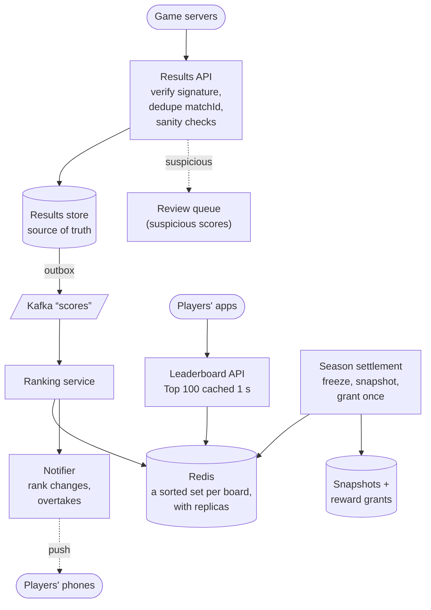

# Global Game Leaderboard

**The prompt:** "Design a global leaderboard for a game — many games, scores arriving all the time, a real-time Top 100, 'my rank', a friends board, and seasons that end and pay out rewards." A candidate for a Disney Product Software Engineer 2 role reported exactly this, and said the interviewer wanted clarifying questions and valued creativity around the player's "victory" moment. Disney's games push is real: a $1.5B stake in Epic Games (Feb 2024) to build a persistent Disney universe connected to Fortnite. What it tests: what a sorted set gives you and what it costs; why **exact rank** — not the Top 100 — is the hard query; ties; going past one node; a durable source of truth behind a derived view; cheating at ingest; and settling a season exactly once. Related: [21 · fantasy sports](21_Fantasy_Sports.md) (standings, corrections), [28 · trending](28_Trending_Top_10.md) (top-K when exact counts cost too much), [18 · traffic spikes](18_Premiere_Traffic_Spike.md) (the season-end rush).

## Clarify first

**Functional**

- Game servers report match results; a board per (game, season, region, mode) — global and regional.
- Reads: the Top 100; my rank and score; the players just above and below me; my friends, ranked.
- **Best score or cumulative points?** Ask — the storage and the update differ.
- **Ties:** who ranks higher? Usually whoever got there first.
- Seasons: a fixed start and end; at the end, freeze, pay out rewards by rank or percentile, start fresh.
- Moments: "you climbed to #42", "Sam just passed you".
- Cheaters: suspicious scores held for review; a ban removes the player from every board.

**Non-functional — say numbers**

- Scale: 100M players on the biggest board, 10M daily actives.
- A new score shows in ranks within **~1–2 s**; reads at p99 ≤ 50 ms.
- An accepted result is never lost, a duplicate never counts twice, and rewards are granted exactly once.
- Availability over freshness: a board a few seconds stale is fine; a board that's down isn't.

## Back-of-envelope

- **Writes:** 10M players × ~20 matches ≈ 200M results a day ≈ **2.3K/s**, ~20K/s at evening and event-weekend peaks.
- **Reads:** 10M × ~10 board views ≈ 1.2K/s, ~10–20K/s at peak — most of them the same Top 100.
- **One sorted set:** ~100 bytes per entry → 100M players ≈ **10 GB**, which fits in one Redis node's memory. CPU is the real limit: one node does on the order of 100K simple ops a second, and each update is O(log N) ≈ 27 steps at 100M. One board on one node works up to tens of millions of players.
- **Many boards:** 50 games × 4 regions × a few modes ≈ hundreds of boards, most of them small. Only the biggest one or two ever need sharding.
- **Results store:** 200M rows × ~200 bytes ≈ 40 GB a day — durable and append-only.

## API

```text
POST /v1/results               game server → us, signed
     { matchId, gameId, mode, region, startedAt, players: [ { playerId, score } ] }
     → 202; the same matchId again is a no-op
GET  /v1/boards/{boardId}/top?limit=100              → [ { rank, playerId, name, score } ]
GET  /v1/boards/{boardId}/players/{id}               → { rank, score, percentile }
GET  /v1/boards/{boardId}/players/{id}/around?n=5    → the 5 above and 5 below
GET  /v1/boards/{boardId}/players/{id}/friends       → friends, ranked
boardId = {game}:{season}:{region}:{mode}
Push: RANK_CHANGED { from, to } · OVERTAKEN { by }
```

- **Results come from game servers, never from clients** — a client can claim any score it likes.
- The Top 100 is the same for everyone, so it's cached for ~1 s (even at the CDN); rank, neighbours and friends are per player.

## Data model

```text
match_result  (match_id PK, game_id, season_id, region, mode, started_at,
               results [ {player_id, score} ], server_sig)       append-only truth
player_score  (board_id, player_id, best | total, achieved_at,
               applied_matches, version)                        per-board aggregate
season        (season_id, game_id, starts_at, ends_at,
               status ACTIVE | FROZEN | SETTLED, reward_tiers)
reward_grant  (season_id, player_id, tier, delivered,
               PRIMARY KEY (season_id, player_id))              settles once
Redis         lb:{boardId}  sorted set: member = playerId, score = packed(score, tiebreak)
```

- **The results store is the truth; Redis is a view.** Lose Redis, and it's rebuilt from `player_score` or by replaying results.
- **`match_id` as the primary key** turns a retried submission into a no-op.
- **`reward_grant`'s primary key** makes settlement re-runnable: a second run inserts nothing.

## Architecture



**The life of a score**

1. A match ends; the game server signs the result and posts it. The results API checks the signature, rejects impossible scores and writes the row — a duplicate matchId is a no-op → `202`.
2. The outbox publishes it; the ranking service updates the board (one `ZADD … GT` for a best-score board) and the player's aggregate.
3. It compares the player's rank before and after: a big jump, or a friend overtaken, becomes a push.
4. Reads: the Top 100 from a 1-second cache; my rank, my neighbours and my friends straight from a Redis replica.

## Deep dives

### 1. Sorted sets, and what each query costs

- A Redis sorted set is a skip list plus a hash: `ZADD` is O(log N), `ZREVRANK` (my rank) O(log N), `ZREVRANGE 0 99` (Top 100) O(log N + 100), `ZSCORE` O(1).
- **Best score:** `ZADD key GT score player` only ever raises a score (Redis 6.2+) and still adds new players — one atomic command, no read-then-write race. **Cumulative:** `ZINCRBY`.
- **The Top 100 is the easy part:** everyone asks the same question, so one cached answer serves millions. **Exact rank for any player** is the hard part — it's what forces everything into one ordered structure.
- **Why not SQL?** `ORDER BY score DESC LIMIT 100` on an index is fine. But "my rank" is `SELECT COUNT(*) … WHERE score > :mine` — a scan as long as your rank: 60M index entries for the player at #60,000,000, on every refresh.

### 2. Ties

- At equal scores Redis falls back to the order of the member strings — deterministic but meaningless (on a high-to-low board, "zoe" outranks "aaron").
- **Pack the tiebreak into the score:** `packed = score × 2^k + (2^k − 1 − t)`, with t the seconds since the season started, so at equal scores the earlier player is higher.
- **Stay under 2^53:** sorted-set scores are doubles, exact only up to 2^53. A 90-day season needs k = 23 bits of seconds (2^23 s ≈ 97 days), which leaves 30 bits — scores up to ~1 billion. Check the bounds, or ranks go subtly wrong.
- **A bonus:** with packed scores, `ZADD GT` keeps the *first* time a player reached their best — a later equal score packs smaller and is ignored.
- **Shared ranks** ("1, 2, 2, 4"): rank = 1 + the players with a strictly higher raw score = 1 + `ZCOUNT key (s+1)·2^k +inf` (LLD).

### 3. Past one node

- **When:** around 100K ops a second, or a board in the hundreds of millions. Most games never get there — say so.
- **Shard by player** (hash of playerId over N shards): writes spread evenly. Top 100 = each shard's top 100, merged. My rank = 1 + Σ over shards of `ZCOUNT shard (mine +inf` — N calls in parallel. Fine for N ≈ 10–50.
- **Shard by score range** instead, and one shard answers each rank query — but popular ranges run hot, and the ranges need rebalancing as scores drift. Usually worse.
- **Or change the product:** exact rank for the top ~10K, a **percentile** for everyone else ("top 3%") from a histogram of score buckets — a thousand counters instead of a 100M-entry structure. Nobody feels the difference between #4,312,909 and "top 31%", and the second is kinder.

### 4. The truth, and rebuilding the view

- Every accepted result is durable before it's ranked, so Redis can always be rebuilt: reload `player_score` (one pipelined `ZADD` per player — minutes for 100M) or replay results.
- **Make the apply idempotent:** a best-score `ZADD GT` already is — replaying a result changes nothing. `ZINCRBY` isn't, so record the applied matchIds per player (or apply from `player_score` with a version check) before incrementing.
- Replicas serve reads and take over on failover. Asynchronous replication can lose the last second of writes; the outbox replays them.

### 5. Cheating

- Results are signed by authoritative game servers. A score from a client is never accepted.
- **Sanity rules:** a maximum possible score per mode and match length; improvements too fast to be human; statistical outliers → held for review and not ranked until cleared.
- **A ban** removes the player from every board (`ZREM`), and this season's rewards are recomputed. Some games **shadow-ban** instead: the cheater still sees themselves ranked, so they don't just make a new account.
- **A freeze period** (say 24 h) at season end gives review time to finish before rewards go out.

### 6. Seasons and settlement

- One key per (board, season): a new season starts a new, empty key; the old one is snapshotted and expires later.
- **Ending on time:** matches count by when they *started*, so results from matches still running at the deadline count for the old season within a grace period.
- **Settle as a re-runnable batch:** freeze → snapshot the board in pages to storage → compute tiers (top 100, top 1%, top 10%) → insert grants keyed (season, player) → deliver each with the grant as its idempotency key → mark SETTLED. A crash anywhere: run it again.
- **The last-hours rush:** everyone plays before the deadline — pre-scale for it ([note 18](18_Premiere_Traffic_Spike.md)).

### 7. The victory moment

- The interviewer valued this, so make it a requirement. After each match, show the change ("#57 → #42") — the ranking service has both ranks in hand.
- **"You passed Sam":** the players between the new and the old rank (`ZREVRANGE newRank oldRank−1`), intersected with friends.
- **"Sam passed you":** a push to the overtaken friend, rate-limited to one an hour — a nudge to play, not spam.
- **Give everyone a board they can win:** regional and friends boards, and small leagues with weekly promotion and demotion (like Duolingo's) — #31,000,000 in the world is #3 in your league.
- **Percentile badges** ("top 8%") for the long tail, and a recap when the season ends.

## LLD

Packing a score with its tiebreak, exactly, inside a double:

```java
public final class PackedScore {
    static final int TIME_BITS = 23;                                   // 2^23 s ≈ 97 days per season
    static final long MAX_SCORE = (1L << (53 - TIME_BITS)) - 1;        // packed values stay under 2^53

    static long pack(long score, long secondsIntoSeason) {
        if (score < 0 || score > MAX_SCORE) throw new IllegalArgumentException("score out of range");
        long t = Math.min(Math.max(secondsIntoSeason, 0), (1L << TIME_BITS) - 1);
        return (score << TIME_BITS) | ((1L << TIME_BITS) - 1 - t);    // equal scores: earlier packs bigger
    }

    static long score(long packed)          { return packed >>> TIME_BITS; }
    static long floorOfNextScore(long score) { return (score + 1) << TIME_BITS; }   // lowest packed value above `score`
}
```

The board operations — written against a thin interface whose methods are single Redis commands, so the logic can be tested with an in-memory board:

```java
public interface Board {                                  // one sorted set: lb:{boardId}
    boolean zaddGt(String player, long packed);           // ZADD key GT packed player
    Long zrevrank(String player);                         // 0-based, highest first; null if absent
    Double zscore(String player);
    long zcount(double min, double max);                  // inclusive bounds
    List<Entry> zrevrange(long from, long to);            // highest first, inclusive
    List<Double> zmscore(List<String> players);           // ZMSCORE: one round trip
    long zcard();
}

public record Entry(String player, long packed) {}
public record Ranked(long rank, String player, long score) {}

public final class Leaderboard {
    private final Board board;

    public Leaderboard(Board board) { this.board = board; }

    public void submitBest(String player, long score, long secondsIntoSeason) {
        board.zaddGt(player, PackedScore.pack(score, secondsIntoSeason));    // only raises; a replay changes nothing
    }

    /** "1, 2, 2, 4": everyone with a strictly higher raw score, plus one. */
    public long sharedRank(String player) {
        Double packed = board.zscore(player);
        if (packed == null) return -1;
        long higher = PackedScore.floorOfNextScore(PackedScore.score(packed.longValue()));
        return board.zcount(higher, Double.POSITIVE_INFINITY) + 1;
    }

    public List<Ranked> around(String player, int n) {
        Long r = board.zrevrank(player);
        if (r == null) return List.of();
        long from = Math.max(0, r - n);
        List<Entry> page = board.zrevrange(from, r + n);
        return IntStream.range(0, page.size())
                .mapToObj(i -> new Ranked(from + i + 1, page.get(i).player(), PackedScore.score(page.get(i).packed())))
                .toList();
    }

    public List<Ranked> friends(String player, List<String> friendIds) {
        List<String> ids = new ArrayList<>(friendIds);
        ids.add(player);
        List<Double> scores = board.zmscore(ids);
        List<Entry> present = IntStream.range(0, ids.size()).filter(i -> scores.get(i) != null)
                .mapToObj(i -> new Entry(ids.get(i), scores.get(i).longValue()))
                .sorted(Comparator.comparingLong(Entry::packed).reversed()).toList();
        return IntStream.range(0, present.size())
                .mapToObj(i -> new Ranked(i + 1, present.get(i).player(), PackedScore.score(present.get(i).packed())))
                .toList();
    }
}
```

Sharded by player — rank is a sum of counts, the Top 100 a merge of tops:

```java
long globalRank(List<Board> shards, long myPacked) {                 // packed values are integers
    return shards.parallelStream()
            .mapToLong(s -> s.zcount(myPacked + 1, Double.POSITIVE_INFINITY))   // strictly above me
            .sum() + 1;
}

List<Entry> globalTop(List<Board> shards, int k) {
    return shards.parallelStream()
            .flatMap(s -> s.zrevrange(0, k - 1).stream())            // each shard's own top k
            .sorted(Comparator.comparingLong(Entry::packed).reversed()
                    .thenComparing(Entry::player, Comparator.reverseOrder()))   // ZREVRANGE's order for ties
            .limit(k).toList();
}
```

Settlement that can crash and rerun without granting twice or skipping anyone:

```java
public void settle(Season s) {
    seasons.freeze(s.id());                                          // later matches go to the next season
    long rank = 0, total = s.board().zcard();
    for (long from = 0; from < total; from += 10_000) {              // page through the frozen board
        List<Entry> page = s.board().zrevrange(from, from + 9_999);
        snapshots.write(s.id(), from, page);
        for (Entry e : page) {
            Tier tier = s.tierFor(++rank, total);
            if (tier != Tier.NONE) grants.insertIfAbsent(s.id(), e.player(), tier);   // PK (season, player)
        }
    }
    for (Grant g : grants.undelivered(s.id()))                       // includes any a crash left behind
        if (inventory.grant(g.player(), g.reward(), g.idempotencyKey())) grants.markDelivered(g);
    seasons.markSettled(s.id());
}
```

If the round is object-oriented instead: a `TreeMap` gives the Top-K and neighbours, but its `headMap(…).size()` is O(n), so rank is slow. For bounded integer scores, a Fenwick tree over the scores gives rank in O(log maxScore):

```java
final class ScoreCounts {                                            // how many players have each score
    private final long[] tree;
    ScoreCounts(int maxScore) { tree = new long[maxScore + 2]; }
    void add(int score, int delta) { for (int i = score + 1; i < tree.length; i += i & -i) tree[i] += delta; }
    long atMost(int score) { long n = 0; for (int i = score + 1; i > 0; i -= i & -i) n += tree[i]; return n; }
    long sharedRank(int score, long players) { return players - atMost(score) + 1; }   // a new best: add(old, -1), add(new, +1)
}
```

A season's life: `SCHEDULED → ACTIVE → FROZEN → SETTLED → ARCHIVED`.

## Failure modes

| Failure | What players see | What the design does |
|---|---|---|
| A game server retries a result | Nothing | `match_id` primary key: the second insert is a no-op |
| The Redis primary dies | Ranks briefly stale | A replica takes over; the outbox replays the last writes, and `ZADD GT` makes the replay harmless |
| Redis is lost entirely | "Rankings updating" | Rebuild from `player_score`; serve the last Top 100 snapshot meanwhile |
| The ranking consumer lags | New scores show late | Scale on lag; rank changes are pushed when they land |
| Top 100 read storm at season end | Nothing | One cached answer per board, at the CDN if needed |
| A cheater is found after rewards | Wrong winners | A freeze period before settling; afterwards, revoke and re-settle |
| Settlement crashes halfway | Some rewards late | Rerun: grants are keyed (season, player) and delivered idempotently |
| Clock skew at the season deadline | Disputed last matches | Count by the server's match start time, with a grace period |

## Trade-offs to say out loud

- **Exact vs approximate rank:** exact for the top, percentiles for the tail — far cheaper, and arguably a better product.
- **Real-time vs batch:** some games rebuild ranks every minute; it's cheaper and players rarely notice. Ask how live "live" must be.
- **Shard by player vs by score range:** even writes and fan-out reads vs one-shard reads with hot spots.
- **Redis vs a database:** Redis for rank queries at memory speed, with a durable store behind it; a database alone is fine for Top 100, not for rank.
- **Best vs cumulative:** `ZADD GT` is idempotent; `ZINCRBY` needs dedupe.
- **Global vs league boards:** one fair global truth vs many small boards where most players can win something.

## Trick questions

- **"Why not Postgres with an index on score?"** — Top 100 is fine; "my rank" is a `COUNT(*)` over every higher score — 60M index entries for a mid-table player. Sorted sets answer it in O(log N).
- **"Two players have the same score."** — Pack "who got there first" into the score; equal scores then sort by time, and `ZADD GT` keeps the earlier one.
- **"Why does the packed score have to stay under 2^53?"** — Scores are doubles; above 2^53, neighbouring integers collapse into the same value, so different scores tie and fall back to ordering by player ID.
- **"The same result arrives twice."** — The results store rejects the second matchId; even if it reached Redis, `ZADD GT` with the same value changes nothing.
- **"Exact rank for 100M players across 20 shards?"** — 1 + the sum of each shard's count above my score: 20 parallel O(log n) calls. Or show a percentile below the top 10K.
- **"Top 100 is requested 50K times a second."** — It's one value per board: cache it for a second. That's 1 read a second, not 50K.
- **"Redis lost everything."** — It was never the truth: rebuild from the aggregates, and show the last snapshot while you do.
- **"The season ends while matches are in progress."** — Count matches by start time, accept them during a grace period, then freeze.
- **"A cheater won last season."** — Freeze for review before paying out; after that, revoke and re-run the settlement — it's idempotent.
- **"Show me the players around me."** — `ZREVRANK` to find me, `ZREVRANGE rank−5 rank+5` for the neighbourhood: two O(log N) calls.

## Similar systems

| System | What changes |
|---|---|
| Fantasy league standings ([note 21](21_Fantasy_Sports.md)) | Tiny boards (a league of 10), but stat corrections rewrite history |
| Duolingo leagues | Thousands of small weekly boards with promotion and demotion instead of one giant one |
| Strava segment leaderboards | Millions of small boards (one per segment); ties broken by time; cheating via GPS |
| Coding-contest rankings (LeetCode, Codeforces) | Score first, then penalty time — a tiebreak built into the ranking rule |
| Trending / Top 10 ([note 28](28_Trending_Top_10.md)) | Top-K over counts that never stop growing, where approximate counts are fine |
| App-store and best-seller charts | Ranked by recent velocity, not all-time totals |

## Commonly asked

- Design Top 100 and "my rank" for 1M players — then for 100M. What changes?
- How do you break ties, and why does the score have to stay below 2^53?
- Why not a relational database with an index on score?
- How do you make score submission safe to retry, and the leaderboard rebuildable?
- How do you end a season and pay out rewards exactly once?
- How do you stop cheaters?
- How would you make players feel their wins?

## Sources

- [Global leaderboard — Disney Product Software Engineer 2 (LeetCode Discuss)](https://leetcode.com/discuss/post/8501988/the-walt-disney-company-product-software-ysis/) · [Disney invests $1.5B in Epic Games (VGC)](https://www.videogameschronicle.com/news/disney-is-investing-1-5b-in-epic-games-and-building-a-new-universe-connected-to-fortnite/)
- [ZADD: GT/LT since 6.2, scores exact to 2^53, ties ordered by member (Redis)](https://redis.io/docs/latest/commands/zadd/) · [ZMSCORE (Redis)](https://redis.io/docs/latest/commands/zmscore/)
