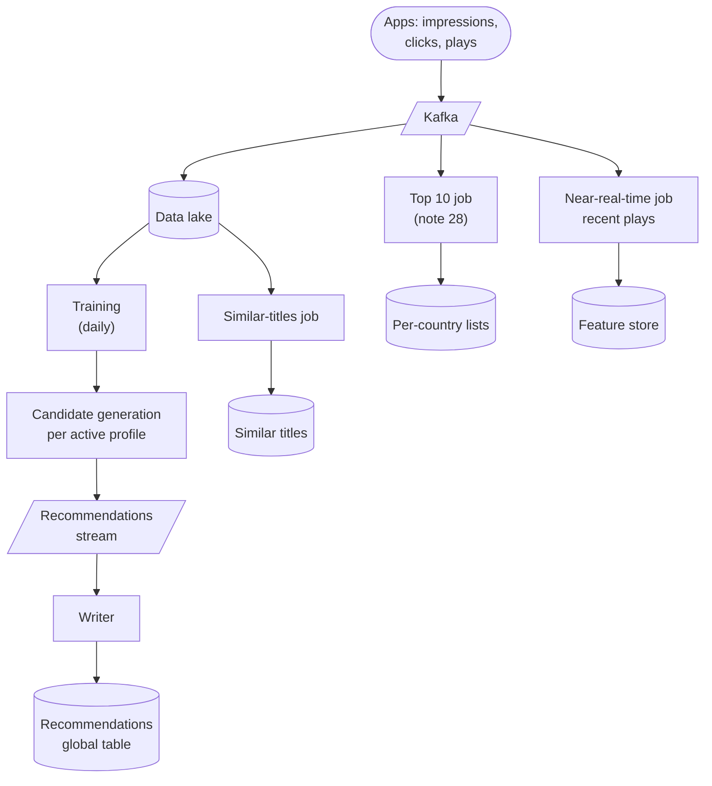
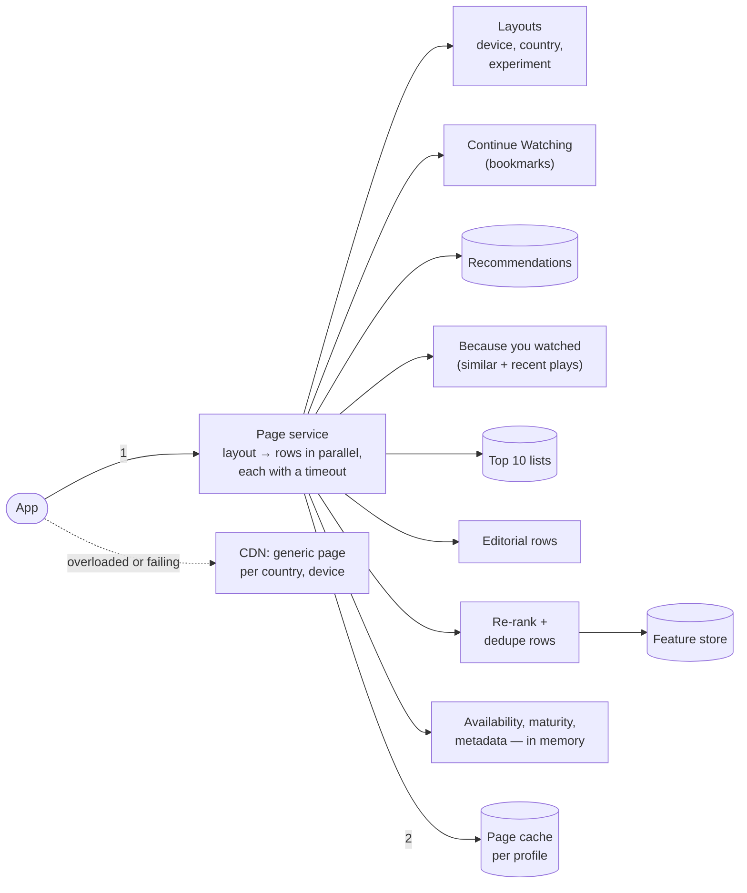

# Home Page & Recommendations (Disney+)

**The prompt:** "Design a 'Continue Watching' and Recommendations service for Disney+ that works across multiple devices, supports millions of users, and remains responsive during traffic spikes like major show releases." That's a first-hand report from a Disney Streaming SWE II loop (75 minutes with two senior engineers). It's the home page: a stack of rows — Continue Watching, recommendations, Top 10, new releases, collections — built per profile in a few hundred milliseconds. Disney's engineers have described the shape themselves (re:Invent 2020): a machine-learning pipeline pushes hundreds of millions of recommendations a day through Kinesis into a DynamoDB global table, and billions of bookmarks a day arrive the same way. What it tests: the **offline/online split** (precompute candidates, assemble fast); a page of **rows that fail independently**; Continue Watching that's right on every device; freshness inside a session; cold start; caching something personalized; and degrading gracefully at a premiere. Related: [17 · video streaming](17_Disney_Plus_Video_Streaming.md), [18 · traffic spikes](18_Premiere_Traffic_Spike.md) (panic mode), [32 · catalog & rights](32_Catalog_Rights_Availability.md) (every tile is filtered), [28 · Top 10](28_Trending_Top_10.md), [27 · search](27_Search_Autocomplete.md), and tracker #14 (the Continue Watching write path in full).

## Clarify first

**What Disney+ shows today:** brand tiles (Disney, Pixar, Marvel, Star Wars, National Geographic, and Hulu — which replaced Star outside the US in October 2025), then rows: Continue Watching, recommendations, "Top 10 Today", new and coming soon, collections. The page differs by country, by profile (Junior profiles get kids' content only) and by device.

**Functional**

- One page per profile, device type (TV, phone, web), country and language.
- **Continue Watching** that's right on every device within seconds — the reported half.
- Recommended for you; "Because you watched X"; Top 10 Today; new and coming soon; genre and franchise collections; editorial rows.
- Every tile available in this country and allowed for this profile.
- Rows below the fold load as the user scrolls; rows page sideways.
- Signals back: impressions, clicks, plays, completions.

**Non-functional — say numbers**

- Disney+ and Hulu had 195.7M subscriptions (Sept 2025); assume ~50M daily active profiles.
- Server time p95 ≤ ~300 ms for the page, sooner for the first rows.
- Premieres bring 10–50× normal traffic ([note 18](18_Premiere_Traffic_Spike.md)).
- **Never an empty page:** a page missing a row beats an error, and a generic page beats nothing.
- Freshness: Continue Watching within seconds across devices; recommendations within hours, nudged within a session.

**Say what's out of scope:** playback ([note 17](17_Disney_Plus_Video_Streaming.md)), search ([note 27](27_Search_Autocomplete.md)), how the models are trained, A/B infrastructure (tracker #36), ads (#37).

## Back-of-envelope

- **Page loads:** 50M profiles × ~4 a day = 200M ≈ **2.3K/s**; a premiere at 30× ≈ **70K/s**.
- **Tiles:** ~20 rows × ~20 tiles ≈ 400 per page → **~30M metadata lookups/s** at that peak. They have to be in-process memory, not network calls — and they can be: tens of thousands of titles × a few KB of metadata is ~100 MB per language.
- **Precomputed rows:** 100M profiles × ~10 rows × ~50 titles × ~8 bytes ≈ **400 GB** — a key-value store's job, one key read per page.
- **Disney's numbers (2020):** over 3 billion content-API requests on launch day; hundreds of millions of recommendations and billions of bookmarks a day, both over Kinesis into DynamoDB.
- **Online ranking:** ~500–1,000 candidates through a small model is a few milliseconds of CPU — if the features are already computed.

## API

```text
GET  /v1/home?profileId=…&device=tv&locale=fr-FR          country from the request
     → { pageId, rows: [ { rowId, kind, title,
                           items: [ { titleId, art, progress? } ], nextCursor } ],
         lazyRows: [ rowId… ], ttlSec }
GET  /v1/home/rows/{rowId}?pageId=…&cursor=…               a lazy row, or a row's next page
POST /v1/events   { profileId, type: IMPRESSION | CLICK | PLAY | COMPLETE,
                    titleId, rowId, position, ts }           batched by the app
```

- The first paint needs ~5 rows, not 20: the rest come back as IDs and load as the user scrolls.
- `pageId` ties lazy rows to the same page, so titles aren't repeated and the order doesn't reshuffle.
- Events carry `rowId` and `position` — without them you can't tell a good recommendation from a good slot.

## Data model

| Entity | Key fields | Store |
|---|---|---|
| Recommendations | profileId → { rowType → [ (titleId, score) ] }, modelVersion, computedAt | Key-value global table, written by the ML pipeline |
| Similar titles | titleId → [ titleId ] (watched together, similar content) | Key-value, rebuilt daily |
| Bookmarks | (profileId, titleId) → episode, position, updatedAt | Key-value global table (tracker #14) |
| Profile features | profileId → genre affinities, recent plays, devices | Feature store (online + offline) |
| Title metadata | titleId → localized names, art, ratings | In memory on every node |
| Layouts | (device, country, experiment) → row templates, editorial rows | Config service, cached |
| Events | impressions, clicks, plays | Kafka → data lake |

- **Precompute per profile; read with one key.** Disney's design: ML → a Kinesis stream → a writer → a DynamoDB global table, read by the Content API.
- **Small catalog, big audience:** every title's metadata fits in each node's memory; per-profile data doesn't, so it lives in the key-value store.
- **Global tables** replicate to every region, so a region can be evacuated and its users served elsewhere.

## Architecture

**Offline — computing recommendations**



**Online — building the page**



**Building a page**

1. The page service gets (profile, device, country, language, experiment) and loads that layout: which rows, in what default order.
2. It asks every row source in parallel, each with its own budget (~50–80 ms) and a fallback.
3. It re-ranks inside rows with fresh session features, orders the rows, and drops titles repeated across rows.
4. It filters every tile for availability and maturity and fills in metadata and art — all in memory.
5. It returns the first ~5 rows and IDs for the rest, and caches the page for the profile briefly.

## Deep dives

### 1. Candidates offline, ranking online

- **The funnel:** candidate sources — collaborative filtering (embeddings and nearest neighbours), "watched together", content similarity (genre, cast, franchise), trending, new releases, editorial — narrow the catalog to a few hundred titles per profile, and a ranking model orders them. YouTube's 2016 paper made this two-stage split the standard design.
- **Precompute what's expensive:** a daily batch scores every active profile and writes its rows to the key-value store — Disney's pipeline moves hundreds of millions of recommendations a day this way. Inactive profiles are computed on their first visit, or get the cold-start page.
- **Re-rank online:** the batch is hours old; re-ranking with session features (what was just watched, time of day, device) fixes the order without recomputing candidates.
- **A small catalog changes the maths:** Disney+ has tens of thousands of titles, not YouTube's billions of videos — scoring every candidate online is affordable; latency and fresh features are the hard parts.
- **Why it matters:** Netflix reported in 2015 that recommendations influenced about 80% of the hours streamed.

### 2. A page of rows that fail on their own

- Each row is a source with its own timeout and fallback: Continue Watching from bookmarks, recommendations from their table, Top 10 from precomputed lists, editorial from the content system.
- **A slow row is dropped or filled from its fallback** (a cached copy, a generic version): the page never waits for its slowest row, and never fails because one did.
- **Row order is ranked too.** Netflix described choosing rows greedily: the most useful next row that isn't too similar to the rows already chosen.
- **Dedupe across rows:** a title already on the page drops out of lower rows; a row left with too few titles is dropped.
- **Lazy rows:** only the first few rows are built up front; the rest load from the same page snapshot as the user scrolls.

### 3. Continue Watching — the reported half

- **Writes:** the player sends progress every few seconds and on pause, seek and stop → a stream (Disney's carries billions of bookmarks a day over Kinesis) → a writer upserts `(profileId, titleId)` with a **conditional write**: only if this update is newer than the stored one. An update that arrives late from another device can't move the position backwards (LLD).
- **Which "newer"?** Compare the time the ingest API received the update, not the device's own clock — a phone whose clock runs fast would otherwise always win.
- **Reads:** the profile's bookmarks → drop finished titles (past the credits, or moved on to the next episode) → filter for availability and maturity → most recent first.
- **Across devices in seconds:** the row isn't served from the page cache (or a new bookmark clears it), so the TV sees where the phone stopped.
- **Multi-region:** last-writer-wins replication is fine *here* — the only conflict is one profile on two devices, and the latest position winning is exactly the product behaviour. Volumes, coalescing and the rest of the write path are tracker #14.

### 4. Freshness inside a session

- Watch a horror film, and the batch rows still think you love cartoons until tomorrow.
- **Near-real-time features:** a stream job updates recent plays and genre affinities within seconds; the next page load's re-ranking reads them.
- **"Because you watched" from the last play:** look up what's similar to the title just watched — one key-value read, fresh without rerunning a model.
- **Clear the page cache on intent:** a play, a watchlist add or a search.

### 5. Cold start

- **New profile:** what's popular in the country and age rating, onboarding picks ("choose three you like"), device and time of day — then personal rows after a few plays.
- **Kids and Junior profiles:** their own candidate pools and rows — never adult rows filtered down to gaps.
- **New title:** no watch history yet, so content features (franchise, genre, cast, embeddings), editorial placement, and **exploration slots** — show it to some viewers, learn, adjust (a bandit).
- **Premieres are a business decision,** not a model output: pinned to the hero and the top rows.

### 6. Caching something personalized

- **The app shows its last page instantly** and refreshes in the background (stale-while-revalidate): the fastest page is the one already on the device.
- **Per-profile page cache:** minutes long, cleared by plays and watchlist changes.
- **Hot keys:** at a premiere, millions of pages read the same title record. Disney's deck shows the fix: split the hot key into N copies (`content_id.abc123.1 … .n`) and map each client to one of them.
- **Generic pages at the CDN** per (country, device, language): the fallback when personalization is down, and a first page for brand-new profiles.

### 7. Premiere day

- **Pre-scale and pre-warm** ([note 18](18_Premiere_Traffic_Spike.md)). Disney pre-partitioned DynamoDB before launch: a big influx into an empty table means lots of partition splitting, so they set a high provisioned write capacity ahead of time, let the partitioning run (it took several hours), then switched back to on-demand.
- **Degrade by level:** drop the expensive rows and online re-ranking first → then serve the stored precomputed rows as they are → then the generic CDN page, with Continue Watching from the app's own cache.
- **The premiere title goes where it belongs** — hero, top of rows — by rule, not by model.

### 8. Knowing it works

- **Offline metrics** (recall and NDCG on held-out plays) pick candidates for testing; **online A/B tests** decide, on plays, hours and retention (tracker #36).
- **Interleaving** (Netflix, 2017): mix two rankers' results in one row and see whose titles get played — a fast first pass before a full A/B test.
- **Position bias:** row 1, tile 1 gets plays because of where it is. Log positions, and learn from them, not around them.
- **Where it's going:** Netflix's GenPage (2026) builds the whole page with one generative model instead of separate candidate, ranking and layout stages, and reported 20% lower serving latency.

## LLD

The page service — rows in parallel, each with a budget, falling back lazily:

```java
public interface RowSource {                                   // Strategy: one per kind of row
    CompletableFuture<Row> fetch(PageContext ctx);
    Duration budget();                                         // e.g. 60 ms
    Optional<Row> fallback(PageContext ctx);                   // a cached or generic version, or nothing
}

public record PageContext(String profileId, String country, Device device, MaturityLevel maturity) {}
public record Row(String rowId, String title, List<String> titleIds) {}

@Service
public class PageService {
    private static final int MIN_TILES = 4;
    private final Layouts layouts;                             // which rows, in which default order
    private final Map<RowKind, RowSource> sources;
    private final RowRanker rowRanker;                         // orders rows for this profile
    private final Availability availability;                   // note 32, in memory

    public Page build(PageContext ctx) {
        List<CompletableFuture<Optional<Row>>> pending = layouts.forContext(ctx).stream()
                .map(spec -> {
                    RowSource src = sources.get(spec.kind());
                    return src.fetch(ctx)
                            .thenApply(Optional::of)
                            .completeOnTimeout(Optional.empty(), src.budget().toMillis(), MILLISECONDS)
                            .exceptionally(ex -> Optional.empty())
                            .thenApply(row -> row.or(() -> src.fallback(ctx)));   // slow or failed: fall back
                })
                .toList();
        List<Row> rows = pending.stream().map(CompletableFuture::join).flatMap(Optional::stream).toList();

        Set<String> onPage = new HashSet<>();
        List<Row> page = new ArrayList<>();
        for (Row row : rowRanker.order(ctx, rows)) {
            List<String> ids = new ArrayList<>();
            for (String id : row.titleIds())
                if (availability.playable(id, ctx.country(), ctx.maturity()) && onPage.add(id)) ids.add(id);
            if (ids.size() >= MIN_TILES) page.add(new Row(row.rowId(), row.title(), ids));   // too thin: drop it
        }
        return new Page(page);
    }
}
```

- Every future completes within its own budget, so `join` waits at most for the slowest *budget*, never for the slowest service.
- `Optional.or` computes a fallback only for rows that need one.
- The availability check runs on every tile, even precomputed ones: a title taken down after last night's batch must not appear ([note 32](32_Catalog_Rights_Availability.md)).

Keeping one franchise from filling a row — maximal marginal relevance, trading relevance against similarity to what's already picked:

```java
public record Scored(String titleId, double score) {}

static List<String> diversify(List<Scored> candidates, int k, double lambda, BiFunction<String, String, Double> similarity) {
    List<Scored> pool = new ArrayList<>(candidates);
    List<String> picked = new ArrayList<>();
    while (picked.size() < k && !pool.isEmpty()) {
        Scored best = null;
        double bestValue = Double.NEGATIVE_INFINITY;
        for (Scored c : pool) {
            double redundancy = picked.stream().mapToDouble(p -> similarity.apply(c.titleId(), p)).max().orElse(0);
            double value = lambda * c.score() - (1 - lambda) * redundancy;   // lambda = 1: pure relevance
            if (value > bestValue) { bestValue = value; best = c; }
        }
        picked.add(best.titleId());
        pool.remove(best);
    }
    return picked;
}
```

Continue Watching's "newest wins" — a DynamoDB conditional write (AWS SDK v2):

```java
public void save(Bookmark b) {                                 // b.receivedAtMs() is stamped by the ingest API
    try {
        dynamo.updateItem(UpdateItemRequest.builder()
                .tableName("bookmarks")
                .key(Map.of("profileId", str(b.profileId()), "titleId", str(b.titleId())))
                .updateExpression("SET episodeId = :ep, positionMs = :pos, updatedAt = :ts")
                .conditionExpression("attribute_not_exists(updatedAt) OR updatedAt < :ts")
                .expressionAttributeValues(Map.of(
                        ":ep", str(b.episodeId()), ":pos", num(b.positionMs()), ":ts", num(b.receivedAtMs())))
                .build());
    } catch (ConditionalCheckFailedException olderThanStored) {
        // a late update from another device: dropping it is the correct outcome
    }
}

private static AttributeValue str(String v) { return AttributeValue.builder().s(v).build(); }
private static AttributeValue num(long v)   { return AttributeValue.builder().n(Long.toString(v)).build(); }
```

A row's life on one page load: `REQUESTED → (FILLED | TIMED_OUT → FALLBACK | DROPPED) → FILTERED → SHOWN`.

## Failure modes

| Failure | What viewers see | What the design does |
|---|---|---|
| The recommendations table is slow | Generic rows instead of personal ones | Row timeout → its fallback (yesterday's rows, popular in the country) |
| The feature store is down | Slightly worse ordering | Skip online re-ranking; use the precomputed order |
| Bookmarks are slow | Continue Watching missing or stale | The app's cached row; the page never waits for it |
| The page service is overloaded at a premiere | A generic page | Panic levels end at the CDN page per country and device |
| A bad model ships | Odd recommendations | Rows carry the model version; canary first; roll back to the previous version's rows |
| A title is taken down | It's still in precomputed rows | The availability check on every tile drops it |
| One title record is red-hot | A hot partition | N copies of the key, each client mapped to one; metadata in memory |
| The nightly batch fails | Day-old rows | Keep serving yesterday's rows (`computedAt` says how old) and alert |

## Trade-offs to say out loud

- **Precompute vs compute per request:** cheap, fast reads vs freshness. Precompute candidates, compute the order.
- **Personalization depth vs the latency budget:** every extra model call comes out of ~300 ms.
- **Per-row timeouts:** a complete page vs a fast one — fast, with fallbacks.
- **Explore vs exploit:** new titles need exposure to earn data; every exploration slot costs a little engagement now.
- **Caching:** a slightly stale page now vs a fresh one later — stale-while-revalidate on the device gives both.
- **One generative model vs a pipeline of stages:** simpler serving and whole-page optimization (GenPage) vs stages you can debug, override and swap one at a time.

## Trick questions

- **"Why not compute recommendations on every request?"** — Hundreds of models' worth of work per page, at 70K pages a second during a premiere. Precompute candidates daily; re-rank online.
- **"Two devices send progress out of order. Which wins?"** — The newer one, by the ingest API's receive time, enforced by a conditional write — not the device clocks.
- **"The recommendations service dies during a premiere."** — Its rows time out and fall back; the rest of the page is fine; at worst the CDN serves a generic page.
- **"A title is in someone's precomputed row, but it just left their country."** — Availability is checked per tile at read time; precomputed lists are never trusted for rights.
- **"Why not cache the home page at the CDN?"** — It's personal. The CDN holds generic pages per country and device as the fallback, not the main path.
- **"A brand-new user."** — Popular in the country, onboarding picks, then personal rows after a few plays.
- **"How do you know the new ranker is better?"** — Offline metrics to shortlist, interleaving to prune, an A/B test to decide — with positions logged to correct for position bias.
- **"The same title shows up in four rows."** — Dedupe across the page, top rows first; a row left too thin is dropped.
- **"Precomputing 300M profiles every night is expensive."** — Only active profiles; the rest are computed on their next visit.
- **"Junior profiles?"** — Their own pools and rows, not adult rows filtered into gaps.

## Similar systems

| System | What changes |
|---|---|
| Netflix homepage | The reference: personalized rows and row selection, personalized artwork (contextual bandits), and now GenPage building the whole page with one model |
| YouTube home | Billions of videos and constant uploads, so candidate retrieval and freshness are the hard parts |
| Spotify home | Shelves like rows; some playlists (Discover Weekly) are batch-computed once a week by design |
| Amazon recommendations | Item-to-item collaborative filtering: "customers who bought this also bought" — "because you watched" for products |
| TikTok For You | One endless feed instead of rows; signals from the current session dominate |
| Search ([note 27](27_Search_Autocomplete.md)) | The same ranking machinery, with a query as the strongest signal |

## Commonly asked

- Design Continue Watching and recommendations for Disney+ (the reported prompt).
- What's precomputed, and what's computed per request? Why?
- How does the page stay fast when one recommendation source is slow?
- Two devices send progress out of order — how does the newest position win?
- How do you handle a new user, and a new title?
- What happens to the home page during a premiere?
- How do you know a new model is better?

## Sources

- [Continue Watching and recommendations — Disney Streaming SWE II review (LockedIn AI)](https://www.lockedinai.com/company-details/DIS/db899eb5-5097-4163-b53b-5ace6c205058) · [How Disney+ scales globally on Amazon DynamoDB (re:Invent 2020, slides)](https://d1.awsstatic.com/events/reinvent/2020/How_Disney_scales_globally_on_Amazon_DynamoDB_DAT304.pdf)
- [Deep neural networks for YouTube recommendations (RecSys 2016)](https://research.google/pubs/pub45530/) · [The Netflix recommender system (ACM TMIS, 2015)](https://dl.acm.org/doi/10.1145/2843948)
- [Learning a personalized homepage (Netflix, 2015)](https://netflixtechblog.com/learning-a-personalized-homepage-aa8ec670359a) · [Interleaving at Netflix (2017)](https://netflixtechblog.com/interleaving-in-online-experiments-at-netflix-a04ee392ec55) · [Artwork personalization (Netflix)](https://netflixtechblog.com/artwork-personalization-c589f074ad76)
- [GenPage (Netflix)](https://netflixtechblog.com/genpage-towards-end-to-end-generative-homepage-construction-at-netflix-77146fba8a08) · [How Netflix built GenPage (InfoQ, 2026)](https://infoq.com/news/2026/07/netflix-llm-homepage-generation)
