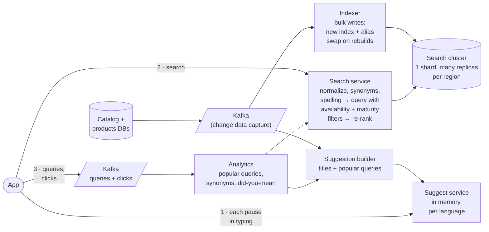

# Search & Autocomplete (Titles and Products)

**The prompt:** "Design search for Disney+ — suggestions as you type, results ranked by relevance and popularity, and only what's playable in the viewer's country. Then the same for shopDisney, with filters by character, category, size and price." Prep guides list it for streaming and for Disney Experiences (shopDisney) roles, and Disney's Bengaluru backend postings ask for Elasticsearch next to Java and Spring. What it tests: how an inverted index works and why `LIKE '%…%'` doesn't; **typeahead** inside a per-keystroke latency budget; typos, accents and many languages; ranking beyond text match (popularity, freshness, the profile); **filtering by availability** without leaking titles or emptying pages; **facets**; and keeping a derived index fresh. Related: [32 · catalog & rights](32_Catalog_Rights_Availability.md) (what's playable where), [26 · home page](26_Home_Page_Recommendations.md) (the same ranking machinery, without a query), [28 · trending](28_Trending_Top_10.md) (popularity signals and "trending searches").

## Clarify first

**Functional**

- **Disney+:** search titles by name, character, cast, franchise or genre ("star wars", "pixar", "christmas movies"); results update as you type.
- **Suggestions after 1–3 characters.** On a TV every letter costs several clicks of the remote, so early suggestions are the product.
- Typos ("mandolorian"), accents, punctuation ("spiderman" vs "Spider-Man"), and titles in the viewer's language *or* the original one.
- Only titles available in this country, and allowed for this profile — kids' profiles too.
- **shopDisney:** products with facets (character, category, size, colour, price) and counts per value; sort by relevance, price or newest; hide or demote out-of-stock items.
- No results → something useful instead ("did you mean", popular titles).

**Non-functional — say numbers**

- Suggestions at **p99 ≤ ~50 ms** server-side — a keystroke lands every ~150 ms.
- Search with facets at p99 ≤ ~200 ms.
- Freshness: a new title is searchable from the instant its window opens; a takedown disappears within minutes; stock within a minute.
- Size is *not* the problem: Disney+ has tens of thousands of titles and shopDisney tens of thousands of products. Query rate, latency and correctness are.

## Back-of-envelope

- **Searches:** 50M daily profiles × ~0.5 ≈ 25M a day; × ~6 suggestion requests each (one per pause in typing) ≈ 150M a day ≈ **1.7K/s**, ~10K/s at peak.
- **A premiere:** everyone types the same title — one popular query, worth caching for a minute.
- **Index size:** 30K titles × ~40 languages × ~2 KB ≈ **2.4 GB** — it fits in memory on every node. Replicate it everywhere instead of sharding it.
- **Suggestion data:** titles × languages + popular queries ≈ a few million strings — tens of MB per language as a trie or FST.
- **shopDisney:** ~100K SKUs, quiet most days, with spikes at merchandise drops and holidays.

## API

```text
GET /v1/suggest?q=man&profileId=…&locale=fr-FR             country from the request
    → [ { text, titleId?, kind: TITLE | QUERY | PERSON } ]       up to 8
GET /v1/search?q=mandalorian&profileId=…&cursor=…
    → { results: [ { titleId, … } ], nextCursor, didYouMean? }
GET /v1/shop/search?q=mickey+ears&filter=size:adult&filter=character:minnie
                   &sort=relevance&cursor=…
    → { results, facets: { character: [ { value, count } ], size: […], price: [ buckets ] } }
```

- The country comes from the request and the account ([note 32](32_Catalog_Rights_Availability.md)); maturity from the profile — never from query parameters the client can edit.
- Cursors, not page numbers: deep pages cost the engine more the deeper they go (deep dive 8).

## Data model

```text
title doc    { titleId, kind, names: { en: "Frozen", fr: "La Reine des neiges", … },
               aliases: [ "frozen 1" ], characters, cast, franchise, genres, brand,
               minAge: { US: 7, FR: 0, … },                     ratings normalized to an age
               windows: [ { territory, from, to } ],            nested — deep dive 4
               popularity, releasedAt }
product doc  { sku, productId, name, description, characters, category, size, colour,
               price, inStock, popularity, launchAt }
query log    (query, locale, territory, resultCount, clickedId, position, ts)
suggestions  (text, language, kind, targetId, weight)           built from titles + query log
```

- **The index is derived; the catalog is the truth.** Changes flow in by change-data-capture, and the whole index can be rebuilt from scratch.
- **Every language's name, plus aliases:** a French viewer may type the English title; "spiderman" and "spider man" are aliases of "Spider-Man".
- **Ratings become an age per country** at index time, so "allowed for this profile" is one range filter.

## Architecture



**From keystroke to results**

1. The app waits ~100 ms after a keystroke, sends the prefix, and cancels any request still in flight. Answers can arrive out of order, so it shows an answer only if it matches what's in the box now.
2. The suggest service answers from memory: the top completions for that prefix, filtered for country and maturity.
3. On Enter, or a tap on "search", the search service runs the full query against the cluster with the same filters, re-ranks the top hits, and fills in metadata from memory.
4. Every query, result count and click is logged — that's where popular queries, synonyms and "did you mean" come from.

## Deep dives

### 1. The inverted index, and relevance

- **An inverted index** maps each term to the documents containing it — a dictionary lookup per word, where `LIKE '%mand%'` has to scan every row (no index can serve a leading wildcard) and still knows nothing about relevance, typos or languages.
- **Analysis decides what a "term" is:** lowercase, strip accents ("Pokémon" → "pokemon"), split on punctuation, stem per language ("running" → "run"). The query goes through the same analyzer, or nothing matches.
- **Scoring:** Elasticsearch has used **BM25** by default since 5.0 — rare terms count more, repeated terms saturate instead of piling up, and long fields are normalized against short ones.
- **Field boosts:** a hit in the title beats a hit in the cast beats a hit in the synopsis — and an exact title match beats everything, because people mostly type the title they want.

### 2. Suggestions as you type

- **Three ways to build them:**
  - **Elasticsearch's completion suggester** — an in-memory FST, the fastest option, but it matches only from the start of the input: "mand" won't find "The Mandalorian" unless "mandalorian" is indexed as an extra input.
  - **A `search_as_you_type` field** (edge n-grams underneath) — matches the start of any word, so "mand" works out of the box.
  - **Your own trie** in the suggest service, with each node's top completions precomputed — full control, and a lookup is O(prefix length) (LLD).
- **Rank by popularity,** not by text score: plays and searches over the last few days. Two letters typed by millions should give everyone the same, useful answer.
- **Short prefixes are few and the same for everyone** in a country and language — cache them, even at the CDN. Longer prefixes hit the service.
- **Availability and maturity still apply:** keep a few more than k completions per prefix (say 4k) and filter at request time; if too few survive, fall back to a real search.

### 3. Typos, accents and languages

- **Fuzzy matching:** Elasticsearch's `fuzziness: AUTO` allows no edits for terms of 1–2 characters, one for 3–5, and two beyond that — "mandolorian" still finds "Mandalorian". Requiring the first letter to match (`prefix_length: 1`) keeps it fast.
- **"Did you mean":** the best source is the query log — queries that returned nothing, followed by a query that worked.
- **Every language's names in the index,** each with its own analyzer (stemming differs by language). Boost the viewer's language, but still match the original title.
- **Transliteration:** a Hindi title typed in Latin script is a different string — index transliterated aliases.
- **Synonyms and query understanding:** "marvel movies" means brand = Marvel and kind = movie, not text containing "movies". Map known patterns to filters.

### 4. Only what's playable here

- **Filter inside the query, never after it:** asking for the top 20 and then dropping unavailable titles can leave 3. A filter clause also doesn't affect scoring, and Elasticsearch caches it.
- **Windows must be `nested`:** an array of plain objects is flattened, so a title available in France *last year* and in the US *now* would match "France, now". Nested makes each window match as a unit (LLD).
- **Round "now":** a range on `now` changes every millisecond and can't be cached; Elasticsearch's guidance is to round it (`now/m`), so everyone in the same minute shares the cached filter. A title can then appear up to a minute late — and the play-time check stays the authority ([note 32](32_Catalog_Rights_Availability.md)).
- **One index, filtered by country — or one index per country?** With a small catalog, one index with a filter is simpler. Per-country indexes trade ~150× the indexing for slightly cheaper queries.
- **Maturity:** a range on the age for this country. Kids' profiles also boost kids' titles — not just filter the rest out.

### 5. Ranking beyond text

- BM25 alone puts an obscure documentary called "Star" above *Star Wars* for the query "star". Blend in **popularity** (plays in the last week — [note 28](28_Trending_Top_10.md)), **freshness** (new releases), **the profile** (genres it watches) and **business rules** (a premiere).
- **Learning to rank:** take the top ~100 text matches and re-order them with a model trained on clicks and plays — but only the top, because the model is expensive.
- **Position bias:** people click what's first. Log positions, and correct for them when training.
- **Measure it:** zero-result rate, clicks on the top three, how often people retype the query, and time from search to play.

### 6. Facets for shopDisney

- **Counts per value** (Minnie 42, Mickey 31) are aggregations over the filtered results.
- **Multi-select facets:** picking "Adult" must not hide the other sizes from the size facet. Elasticsearch's `post_filter` filters the hits *after* aggregations run, so each facet's counts ignore its own selection while still applying the others (LLD).
- **Browse pages** (a category with no query) are the same for every visitor: render them ahead of time and cache them at the CDN.
- **Stock:** index a coarse in-stock flag through a separate fast path, and check exactly at checkout. During a merchandise drop, stock changes too fast to reindex on every sale (tracker #13).

### 7. Keeping the index fresh

- **Change-data-capture → Kafka → the indexer → bulk writes.** New writes become searchable at the next refresh — every second by default.
- **Index ahead of time:** a premiere's document — with its availability window — goes in days early; the rounded-now filter makes it appear on time. Nothing has to happen at midnight.
- **Takedowns** go through the catalog's fast path ([note 32](32_Catalog_Rights_Availability.md)): update the document, and keep a small deny list checked by the search service in the meantime.
- **Rebuilding:** a mapping or analyzer change needs a new index. Build it beside the old one, switch the alias atomically, keep the old one for rollback.

### 8. Serving at scale

- **Small index → replicate, don't shard:** one primary shard, many replicas per region; any node can answer any query.
- **Separate suggest from search:** suggestions are tiny and constant, searches heavier and spikier — scale them apart.
- **Cache popular queries in the search service** (per query, country, language and maturity band, for ~60 s): Elasticsearch's shard request cache only stores `size=0` results by default, so it won't hold hits for you.
- **Deep pages:** `from + size` is capped at 10,000 by default; past that, use `search_after` with a point in time. Better still, nobody needs page 600 — cap it.

## LLD

A suggestion trie — each node keeps its best completions, precomputed, so a lookup is just a walk down the prefix:

```java
public final class SuggestTrie {
    /** text is what's shown; aliases are other ways to type it; targetId is the title (or the query itself). */
    public record Suggestion(String text, List<String> aliases, String targetId, long popularity) {}

    private static final class Node {
        final Map<Character, Node> children = new HashMap<>();
        final List<Suggestion> endingHere = new ArrayList<>();
        List<Suggestion> top = List.of();                         // the best k at or below this node
    }

    private static final Comparator<Suggestion> BEST =
            Comparator.comparingLong(Suggestion::popularity).reversed().thenComparing(Suggestion::text);
    private final Node root = new Node();
    private final int k;

    public SuggestTrie(Collection<Suggestion> all, int k) {
        this.k = k;
        for (Suggestion s : all)
            for (String spelling : Stream.concat(Stream.of(s.text()), s.aliases().stream()).toList()) {
                Node n = root;
                for (char c : Text.fold(spelling).toCharArray()) n = n.children.computeIfAbsent(c, x -> new Node());
                n.endingHere.add(s);                              // every spelling leads to the same suggestion
            }
        fillTop(root);
    }

    private List<Suggestion> fillTop(Node n) {                    // post-order: children first
        List<Suggestion> candidates = new ArrayList<>(n.endingHere);
        for (Node child : n.children.values()) candidates.addAll(fillTop(child));   // each child's top k only
        candidates.sort(BEST);
        Set<String> seen = new HashSet<>();
        n.top = candidates.stream().filter(s -> seen.add(s.targetId())).limit(k).toList();   // a title once
        return n.top;
    }

    public List<Suggestion> suggest(String prefix) {              // O(prefix length): the answer is stored
        Node n = root;
        for (char c : Text.fold(prefix).toCharArray()) {
            n = n.children.get(c);
            if (n == null) return List.of();
        }
        return n.top;
    }
}

final class Text {
    /** "Pokémon: Spider-Man!" → "pokemon spider man": index and query must fold the same way. */
    static String fold(String s) {
        return Normalizer.normalize(s, Normalizer.Form.NFD)        // é → e + a combining accent
                .replaceAll("\\p{M}", "")                          // drop the accents
                .toLowerCase(Locale.ROOT)
                .replaceAll("[^\\p{L}\\p{N}]+", " ")               // punctuation → one space
                .trim();
    }
}
```

- **Aliases are extra paths to the same suggestion:** "spider man" and "spiderman" are different paths through the trie, and both end at "Spider-Man" — shown once, under its real name.
- **Building is cheap:** each node merges only its children's top k, never everything below it.
- Build one trie per language, with k a few times the number shown, so availability and maturity filtering still leave enough.

The Disney+ title query — fuzzy multi-field match, filters that don't score and do cache, then popularity:

```json
{
  "query": {
    "function_score": {
      "query": {
        "bool": {
          "must": {
            "multi_match": {
              "query": "mandolorian",
              "fields": ["names.fr^3", "names.en^2", "aliases^2", "characters", "franchise", "cast"],
              "fuzziness": "AUTO",
              "prefix_length": 1
            }
          },
          "filter": [
            { "nested": { "path": "windows", "query": { "bool": { "filter": [
                { "term":  { "windows.territory": "FR" } },
                { "range": { "windows.from": { "lte": "now/m" } } },
                { "range": { "windows.to":   { "gt":  "now/m" } } } ] } } } },
            { "range": { "minAge.FR": { "lte": 12 } } }
          ]
        }
      },
      "field_value_factor": { "field": "popularity", "modifier": "log1p" },
      "boost_mode": "multiply"
    }
  },
  "size": 20
}
```

- The viewer's language gets the biggest boost; the original title still matches.
- Everything in `filter` is yes/no: it doesn't change scores, so Elasticsearch can cache it.

shopDisney's facets — `post_filter` narrows the hits after the counts are taken, so the size facet still shows every size:

```json
{
  "query": { "bool": {
    "must":   { "match": { "name": { "query": "mickey ears", "operator": "and" } } },
    "filter": [ { "term": { "inStock": true } } ] } },
  "post_filter": { "terms": { "size": ["adult"] } },
  "aggs": {
    "size":      { "terms": { "field": "size" } },
    "character": { "filter": { "terms": { "size": ["adult"] } },
                   "aggs": { "values": { "terms": { "field": "characters" } } } },
    "price":     { "filter": { "terms": { "size": ["adult"] } },
                   "aggs": { "buckets": { "range": { "field": "price",
                     "ranges": [ { "to": 25 }, { "from": 25, "to": 50 }, { "from": 50 } ] } } } }
  }
}
```

The size facet counts ignore the size selection (so "Kids" still shows its count); every other facet applies it explicitly.

## Failure modes

| Failure | What users see | What the design does |
|---|---|---|
| A search node dies | Nothing | Replicas; any node can answer |
| The indexer falls behind | A change isn't searchable yet | Windows are indexed days ahead; alert on lag; takedowns also use a deny list |
| A bad analyzer or mapping ships | Wrong or missing results | Build beside the old index; switch the alias back |
| The suggest service is down | No suggestions | The app shows recent and popular searches it has cached; search still works |
| No results | An empty screen | Fuzzy match, then "did you mean", then popular titles in the country |
| An expensive query (huge wildcards) | Slow cluster | No leading wildcards, per-query timeouts, circuit breakers |
| Everyone searches the premiere | A hot query | A 60-second cache per query, country and language |

## Trade-offs to say out loud

- **Completion suggester vs `search_as_you_type` vs your own trie:** speed vs matching inside titles vs control.
- **Filter in one index vs an index per country:** simple and small vs ~150× the indexing for slightly cheaper queries.
- **Fuzziness:** more typos forgiven, more wrong matches — `AUTO` with a fixed first letter is a sane default.
- **Refresh interval:** searchable in a second vs indexing throughput. Bulk rebuilds turn refresh off and back on.
- **Personalized ranking vs caching:** the more personal the results, the less any cache helps. Personalize the re-rank, not the candidate query.
- **Elasticsearch vs a hosted search service:** control and cost at scale vs operations someone else runs.

## Trick questions

- **"Why not `WHERE title LIKE '%spider%'`?"** — A leading wildcard can't use an index, so every query scans everything — and it still can't rank, forgive typos or fold accents.
- **"The user types 'spiderman'; the title is 'Spider-Man'."** — Fold punctuation in index and query alike, and index the joined form as an alias.
- **"Search shows a title that isn't available here."** — Filter inside the query on a *nested* window; flattened objects mix one country's window with another's.
- **"A title premieres at midnight. When do you index it?"** — Days before, with its window. The filter on rounded `now` makes it appear on time.
- **"Answers to 'ma' arrive after answers to 'man'."** — The app drops any answer that doesn't match what's in the box now.
- **"Why rank suggestions by popularity rather than text score?"** — Two letters match thousands of titles equally well; what people actually watch is the only useful order.
- **"Show page 600."** — `from + size` stops at 10,000 by default; use `search_after` — or recognize nobody goes there and cap it.
- **"Stock changes a thousand times a second during a drop."** — Don't reindex per sale: a coarse in-stock flag on a fast path, and the exact check at checkout.
- **"A French viewer types the English title."** — Every language's names are indexed; the viewer's language gets the boost, not the only match.
- **"How do you know search got better?"** — Fewer zero-result searches and retyped queries, more clicks in the top three, faster time to play — tested with an A/B test.

## Similar systems

| System | What changes |
|---|---|
| Amazon product search | A huge catalog, facets everywhere, ranking learned from purchases, sponsored placements |
| Spotify search | Many kinds of result at once (songs, artists, podcasts) and dozens of languages and scripts |
| Google autocomplete | Suggestions come from billions of past queries, with policy filtering on what may be suggested |
| Algolia | Typo-tolerant search-as-you-type as a hosted service |
| YouTube search | Billions of documents and constant uploads: freshness and spam matter more than facets |
| Catalog availability ([note 32](32_Catalog_Rights_Availability.md)) | The same windows, checked for every tile instead of every result |

## Commonly asked

- How does an inverted index work, and why not `LIKE '%…%'`?
- Design autocomplete for a TV app. What's precomputed, and what's computed per keystroke?
- How do you handle typos, accents and many languages?
- How do you show only titles available in the viewer's country, without short pages?
- How do faceted filters keep the right counts?
- How does a new title become searchable at exactly the right moment?
- How do you rank: text, popularity, or the profile?

## Sources

- [Similarity: BM25 is the default (Elastic)](https://www.elastic.co/docs/reference/elasticsearch/mapping-reference/similarity) · [Fuzziness AUTO (Elastic)](https://www.elastic.co/docs/reference/elasticsearch/rest-apis/common-options) · [Completion suggester: in-memory FST, prefix only (Elastic)](https://www.elastic.co/blog/you-complete-me) · [search_as_you_type (Elastic)](https://www.elastic.co/guide/en/elasticsearch/reference/current/search-as-you-type.html)
- [Nested field type (Elastic)](https://www.elastic.co/docs/reference/elasticsearch/mapping-reference/nested) · [Filter search results: post_filter (Elastic)](https://www.elastic.co/docs/reference/elasticsearch/rest-apis/filter-search-results) · [Tune for search speed: round "now" (Elastic)](https://www.elastic.co/docs/deploy-manage/production-guidance/optimize-performance/search-speed) · [Paginate search results: 10,000 and search_after (Elastic)](https://www.elastic.co/docs/reference/elasticsearch/rest-apis/paginate-search-results)
- [Senior Software Engineer, Bengaluru — Java, Spring, Elasticsearch (Disney Careers)](https://jobs.disneycareers.com/job/bengaluru/senior-software-engineer/391/93116420784)
