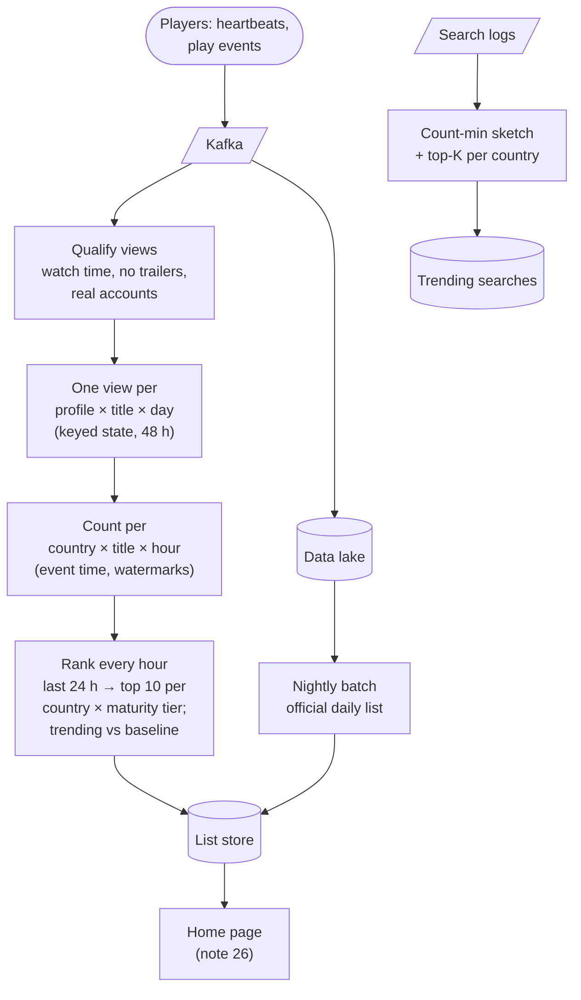

# Trending & "Top 10 Today"

**The prompt:** "Design the 'Top 10 Today' row for Disney+ — the ten most popular titles in the viewer's country, refreshed through the day — and 'trending searches' for search." Disney+ launched "Top 10 Today" worldwide in 2024: per country, movies and series together, ranked on "total views at the episode and movie level within a day" plus "the growing popularity of new titles", shaped by the profile's content rating, and not shown on Junior profiles. Hulu's "Top 15 Today" (2023) ranks the last 24 hours. What it tests: **defining the metric** (a play, a view, a viewer, hours?); counting at scale in a stream; **windows** and late events; knowing when exact counting is enough and when you need **sketches** (count-min sketch, Space-Saving); trending (growth) vs top (volume); lists per country and per rating; resisting gaming; and serving a precomputed list cheaply. Related: [26 · home page](26_Home_Page_Recommendations.md) (where the row lives), [27 · search](27_Search_Autocomplete.md) (trending searches, popularity as a signal), [25 · leaderboard](25_Global_Leaderboard.md) (top-K with exact ranks), [32 · catalog & rights](32_Catalog_Rights_Availability.md) (per-country availability, local time), [17 · video streaming](17_Disney_Plus_Video_Streaming.md) (the heartbeats that feed it).

## Clarify first

**What the services do today:**

- **Disney+ "Top 10 Today"** (2024): per country, since availability differs by market; views are one factor, not "the sole determining factor"; curated partly by the profile's content rating; not on Junior profiles.
- **Hulu "Top 15 Today"** (Sept 2023): the most watched over the past 24 hours, updated once a day; ranked by episode, so a series appears through its most-watched episode; not on kids' profiles.
- **Netflix** has redefined "view" three times: a play of at least two minutes (until 2021), then hours viewed (weekly lists every Tuesday for 90+ countries), and since June 2023 "views" — hours viewed ÷ runtime, so long series and short films compete fairly.

**Functional**

- Ten titles per country, refreshed through the day (say hourly); movies and series together.
- **What counts** — decide it explicitly (deep dive 1): qualified views, one per profile per title per day.
- **Rated per profile:** a profile allowed up to 12+ gets a list built from titles it's allowed to see — not the full list with holes in it. Junior profiles get none.
- **New titles** can rank on growth, not just volume.
- **Trending searches** for search's empty screen — a different, much larger key space.
- Excluded: trailers and autoplay previews, titles unavailable in the country, test and internal accounts.

**Non-functional — say numbers**

- Fresh within the hour; the official daily list reproducible from raw data — "Top 10 in France" is a public claim.
- Inputs at the scale of [note 17](17_Disney_Plus_Video_Streaming.md): ~10M concurrent streams, heartbeats ~330K/s, play starts ~4K/s, bursting far higher at premieres.
- Read on every home page — up to ~70K/s at a premiere ([note 26](26_Home_Page_Recommendations.md)) — so serving must be a memory read.

## Back-of-envelope

- **Qualified views:** a few thousand per second after filtering heartbeats down to "this profile watched this title enough to count" — small for a stream processor.
- **Keys:** 150 countries × ~20K titles ≈ **3M (country, title) counters**. Exact counts with 24 hourly buckets are a few hundred MB. **No sketch needed for titles.**
- **Dedupe state:** (profile, title, day) — 50M daily profiles × ~2 titles ≈ 100M keys a day × ~50 bytes ≈ **5 GB**, kept two days in the stream processor's state.
- **Search queries:** millions of distinct strings per country per day, most seen once. Exact counting stores all of them — this is where sketches pay.
- **Output:** 150 countries × ~5 rating tiers × 10 titles — kilobytes, served from memory.

## API

```text
GET /v1/top10?country=FR&maxAge=12             → { asOf, items: [ { rank, titleId, episodeId? } ] }
GET /v1/trending-searches?country=FR&locale=fr → [ query… ]
Internal event:  ViewQualified { profileId, titleId, episodeId, country, eventTime }
```

- The page service reads lists in-process ([note 26](26_Home_Page_Recommendations.md)); `asOf` lets a stale list say how stale it is.
- The country and the maturity tier come from the request and the profile, as everywhere else.

## Data model

```text
qualified_view  (profile_id, title_id, local_day)       one per profile, title and day
counts          (country, title_id, hour) → views        exact, the last 48 hours
baseline        (country, title_id) → usual views/hour   for trending
top_list        (country, max_age, kind, as_of) → [ title_id × 10 ]
query_sketch    (country, hour) → count-min sketch + top-K candidates
```

- **Lists are derived, and small:** recomputed every hour from counts, stored per (country, maturity tier).
- **The raw events stay in the data lake:** the official daily list is recomputed from them in batch, late events included.

## Architecture



**From a play to the row**

1. Heartbeats arrive (they already exist for stream limits and resume points — [note 17](17_Disney_Plus_Video_Streaming.md)).
2. A view qualifies once the profile has watched enough of a real title — not a trailer, not a preview, not a test account.
3. Keyed state keeps only the first qualified view per (profile, title, local day); replays and rewatches add nothing.
4. Views land in hourly buckets per (country, title) by **event time**; watermarks say when an hour can close.
5. Every hour: sum the last 24 buckets, rank per country and maturity tier, write the lists. The nightly batch writes the final word.

## Deep dives

### 1. Define the metric first

- **The metric is the product.** Play starts are easy to game and inflated by autoplay. A **qualified view** (enough watch time) is better. **Unique profiles** stop one person's loop from counting forty times. **Hours** favour long series. **Hours ÷ runtime** (Netflix since 2023) lets a film and a ten-episode series compete.
- **Episode or title?** Hulu ranks episodes, so a series appears through its most-watched one; Disney+ counts views at the episode and movie level.
- **Say yours out loud,** and why — the interviewer is checking that you noticed the choice exists. Netflix changed its own definition three times.

### 2. Exact counts, when the keys are few

- Disney+ has tens of thousands of titles: 3M (country, title) counters fit easily. Keyed by (country, title), counted in hourly buckets; the last 24 hours is the sum of 24 buckets, kept in a ring (LLD).
- **Top 10 per country** is a scan of ~20K counters with a 10-entry heap — trivial, every hour.
- **Don't reach for a sketch when a hash map fits.** Interviewers often ask about count-min sketches here to see whether you know when *not* to use one.
- **Never count with `UPDATE counts SET n = n + 1` per event:** at a premiere, one title takes most of the views and its row becomes the hottest row in the database. Aggregate in the stream; write once per window.

### 3. Sketches, when the keys are many

- **Trending searches** — millions of distinct queries, most seen once. Exact counts would store them all.
- **Count-min sketch:** d rows of w counters; each key adds 1 to one counter per row; the estimate is the **minimum** across rows. It **never undercounts**, and overcounts by at most ε × (total) with probability 1 − δ when w = ⌈e/ε⌉ and d = ⌈ln(1/δ)⌉. For ε = δ = 0.001, that's 2,719 × 7 ≈ 19K counters — the same size for a thousand distinct queries or a billion.
- **It forgets the keys,** so pair it with a small top-K tracker: when a key's estimate beats the smallest tracked count, it takes that place (LLD).
- **Space-Saving** does both jobs with k counters: an untracked key replaces the smallest counter and inherits its count + 1 — guaranteed to keep any key seen more than N/k times. Snowflake's `APPROX_TOP_K` is an implementation.
- **Both merge:** count-min sketches with the same size and hashes add cell by cell, so each partition sketches locally and one step combines them.

### 4. Windows, late events, and "today"

- **Event time, not arrival time:** a phone that watched offline (downloads) uploads its plays hours later. Flink's watermarks declare "event time has reached t"; windows close when the watermark passes, with **allowed lateness** for stragglers; later still, the nightly batch counts them.
- **"Today" — a calendar day or the last 24 hours?** A calendar day resets at local midnight — at 00:05 the list would be built from five minutes of data. A **rolling 24 hours** (Hulu's choice) changes smoothly. Use rolling for the row, calendar days for official records.
- **Local time per country** — the same problem as availability windows ([note 32](32_Catalog_Rights_Availability.md)): store UTC, and convert at the edges.
- **Two answers on purpose:** the stream gives a provisional list every hour; the batch, with every late event, gives the official one.

### 5. Trending isn't top

- **Top** = volume: what most people watched. **Trending** = growth: what's watched far more than usual. Disney+ blends both — "the growing popularity of new titles".
- **Score growth against an expectation:** (this hour − baseline) ÷ √(baseline + 1) — roughly how many standard deviations above normal, if views behave like a Poisson count. The square root keeps a jump from 1 to 5 views from beating a jump from 10,000 to 15,000.
- **A minimum volume:** below it, nothing trends — tiny counts are noise.
- **Baselines:** an exponentially weighted average, or the same hour last week to cancel the evening peak. **New titles have no baseline** — compare against comparable launches, or against their own first hours.

### 6. Per country, per rating, and small markets

- **One list per (country, maturity tier):** rank only the titles each tier may see. Filtering an adult list for a 12+ profile leaves gaps — six titles in a "Top 10".
- **Which country is a view from?** The account's country (as EU portability rules treat travellers) or the stream's location — pick one and apply it everywhere.
- **Small markets are noisy:** require a minimum number of views, and fall back to a regional list.
- **Publish ranks, not counts** — the numbers are commercially sensitive, and in small markets they could point at individuals.

### 7. Gaming and noise

- **Unique profiles,** not plays: a looping profile counts once a day.
- **Ignore what isn't a choice:** autoplay previews, trailers, and the next episode starting by itself without being watched.
- **Weight trust:** established, paying accounts count fully; brand-new or anomalous ones less. Flag spikes concentrated in a few accounts, devices or networks.
- **Editorial override:** a title pulled for legal reasons must disappear from the list now — the same read-time availability check as every other tile ([note 32](32_Catalog_Rights_Availability.md)).

### 8. Serving it

- The list is tiny and shared: computed hourly, stored per (country, tier), held in memory by the page service, cacheable at the CDN until the next refresh.
- **Stale but present:** if the pipeline stalls, keep serving the last list — `asOf` says how old it is — rather than an empty row.
- **Replay heals the stream:** the job can rewind Kafka and recount, and since the deduped views make every count idempotent, the result is the same.

## LLD

Exact counts for one country over the last 24 hours — hourly buckets in a ring, late events included:

```java
public final class RollingCounts {
    private static final int HOURS = 24;
    private final Map<String, long[]> counts = new HashMap<>();          // titleId → views per hour slot
    private long newestHour = Long.MIN_VALUE;                             // hours since the epoch

    /** One qualified, already-deduplicated view. */
    public void add(String titleId, long eventHour) {
        if (eventHour > newestHour) advanceTo(eventHour);
        if (eventHour <= newestHour - HOURS) return;                     // outside the window: the batch counts it
        counts.computeIfAbsent(titleId, t -> new long[HOURS])[Math.floorMod(eventHour, HOURS)]++;
    }

    private void advanceTo(long hour) {
        long from = newestHour == Long.MIN_VALUE ? hour : Math.max(newestHour + 1, hour - HOURS + 1);
        for (long h = from; h <= hour; h++) {
            int slot = Math.floorMod(h, HOURS);
            for (long[] c : counts.values()) c[slot] = 0;                // a reused slot starts empty
        }
        newestHour = hour;
    }

    public List<Map.Entry<String, Long>> top(int k) {
        PriorityQueue<Map.Entry<String, Long>> heap = new PriorityQueue<>(Map.Entry.comparingByValue());
        counts.forEach((title, c) -> {
            long total = Arrays.stream(c).sum();
            if (total == 0) return;                                      // nothing in the last 24 hours
            heap.offer(Map.entry(title, total));
            if (heap.size() > k) heap.poll();                            // drop the smallest
        });
        List<Map.Entry<String, Long>> out = new ArrayList<>(heap);
        out.sort(Map.Entry.<String, Long>comparingByValue().reversed());
        return out;
    }
}
```

A count-min sketch — fixed size, never undercounts, mergeable:

```java
public final class CountMinSketch {
    private final int width, depth;
    private final long[][] table;

    /** Overcounts by at most epsilon × (total added), with probability 1 − delta. */
    public CountMinSketch(double epsilon, double delta) {
        width = (int) Math.ceil(Math.E / epsilon);
        depth = (int) Math.ceil(Math.log(1 / delta));
        table = new long[depth][width];
    }

    public void add(String key, long n) {
        long[] h = hashes(key);
        for (int row = 0; row < depth; row++) table[row][bucket(h, row)] += n;
    }

    public long estimate(String key) {
        long[] h = hashes(key);
        long min = Long.MAX_VALUE;
        for (int row = 0; row < depth; row++) min = Math.min(min, table[row][bucket(h, row)]);
        return min;
    }

    public void merge(CountMinSketch other) {                            // same epsilon and delta → same shape
        for (int row = 0; row < depth; row++)
            for (int col = 0; col < width; col++) table[row][col] += other.table[row][col];
    }

    private int bucket(long[] h, int row) { return (int) Math.floorMod(h[0] + row * h[1], (long) width); }

    private static long[] hashes(String key) {                           // two 64-bit hashes → one per row
        long h = 0xcbf29ce484222325L;                                     // FNV-1a over the characters
        for (int i = 0; i < key.length(); i++) { h ^= key.charAt(i); h *= 0x100000001b3L; }
        return new long[] { mix(h), mix(h ^ 0x9e3779b97f4a7c15L) | 1 };
    }

    private static long mix(long z) {                                     // SplitMix64's finalizer
        z = (z ^ (z >>> 30)) * 0xbf58476d1ce4e5b9L;
        z = (z ^ (z >>> 27)) * 0x94d049bb133111ebL;
        return z ^ (z >>> 31);
    }
}
```

- Each row's bucket comes from two hashes (h₁ + row × h₂), so a key collides with another in every row only by bad luck — `String.hashCode()` alone would make "Aa" and "BB" collide in all of them.
- No random seeds: every node hashes the same way, so sketches from different partitions merge.

Heavy hitters — the sketch counts every key; a small map remembers the k biggest:

```java
public final class TopK {
    private final CountMinSketch sketch;
    private final int k;
    private final Map<String, Long> top = new HashMap<>();

    public TopK(CountMinSketch sketch, int k) { this.sketch = sketch; this.k = k; }

    public void add(String key) {
        sketch.add(key, 1);
        long estimate = sketch.estimate(key);
        if (top.containsKey(key) || top.size() < k) { top.put(key, estimate); return; }
        Map.Entry<String, Long> smallest = Collections.min(top.entrySet(), Map.Entry.comparingByValue());
        if (estimate > smallest.getValue()) {                            // it overtook the weakest: swap
            top.remove(smallest.getKey());
            top.put(key, estimate);
        }
    }

    public List<String> top() {
        return top.entrySet().stream()
                .sorted(Map.Entry.<String, Long>comparingByValue().reversed())
                .map(Map.Entry::getKey).toList();
    }
}
```

`Collections.min` makes each add O(k) — fine for k = 10–100; a `TreeSet` keyed by (count, key) makes it O(log k).

Trending — how many standard deviations above its usual level a title is this hour:

```java
static double trendScore(long viewsThisHour, double usualPerHour, long minViews) {
    if (viewsThisHour < minViews) return 0;                              // 1 → 5 views is noise, not a trend
    return (viewsThisHour - usualPerHour) / Math.sqrt(usualPerHour + 1);
}

static double nextBaseline(double usualPerHour, long viewsThisHour) {   // exponentially weighted average
    return 0.9 * usualPerHour + 0.1 * viewsThisHour;
}
```

A list's life: `PROVISIONAL (hourly, from the stream) → OFFICIAL (nightly batch) → ARCHIVED`.

## Failure modes

| Failure | What viewers see | What the design does |
|---|---|---|
| The stream job stops | A list that stops moving | Serve the last list with its `asOf`; restart and replay from Kafka |
| Duplicate events (at-least-once delivery) | Nothing | One view per (profile, title, day): duplicates add nothing |
| Plays from offline downloads arrive late | Slightly low counts | Allowed lateness; the nightly batch counts everything |
| A bot farm loops one title | It climbs the list | Unique profiles, trust weighting, spike detection |
| A title is pulled from a country | It's in the precomputed list | The read-time availability check drops it ([note 32](32_Catalog_Rights_Availability.md)) |
| A device clock is wrong | Views in the wrong hour | Bound event times (no future timestamps; clamp to arrival − a day) |
| A small country's list is noise | Odd rankings | Minimum view counts; a regional fallback |

## Trade-offs to say out loud

- **Exact vs approximate:** exact for titles (few keys), sketches for searches (many keys) — say why for each.
- **Rolling 24 hours vs a calendar day:** smooth vs official; use both, for different purposes.
- **Stream vs batch:** fresh and provisional vs complete and final — run both, and let the batch win.
- **Views vs viewers vs hours:** each one favours different titles. Pick and defend.
- **One list per rating tier vs filtering one list:** more lists to compute vs lists with holes.
- **Trending sensitivity:** catch a breakout early vs promote noise — minimum volumes and baselines set the line.

## Trick questions

- **"Do you need a count-min sketch for Disney+ titles?"** — No: 3M exact counters fit in memory. Use one for search queries, where the keys run into millions per day.
- **"The sketch says 'frozen' was searched 10,412 times. Exactly?"** — No: never below the truth, and above it by at most ε × total with probability 1 − δ.
- **"Can you combine sketches from 50 partitions?"** — Yes: same shape and hashes, so add them cell by cell. Space-Saving summaries merge too.
- **"Someone watches the same episode 40 times."** — One view per profile, title and day.
- **"It's 00:05 and the Top 10 is empty."** — A calendar day just reset. Use a rolling 24 hours for the row.
- **"A 12+ profile sees a Top 10 with six titles."** — The list was filtered instead of computed per maturity tier.
- **"Why not increment a counter row in the database per view?"** — At a premiere one title's row takes most of the writes. Aggregate in the stream; write once per window.
- **"A new release has no history. Is it trending?"** — Compare it with comparable launches or its own first hours; Disney+ explicitly weighs new titles' growing popularity.
- **"YouTube retired its Trending page in 2025. Why?"** — Traffic to it had fallen sharply and trends had fragmented; one list for everyone stopped reflecting what people watch. Scope trending — by country, category or tier.

## Similar systems

| System | What changes |
|---|---|
| Netflix Top 10 | Daily rows per country, weekly public lists, and a metric redefined three times — now hours ÷ runtime |
| Hulu Top 15 Today | The past 24 hours, ranked by episode, refreshed once a day |
| YouTube Trending → charts | One global page retired in 2025 for category charts — trending works best scoped |
| Twitter/X trends | Per location, ranked by velocity rather than volume, with heavy spam filtering |
| Spotify charts | Daily and weekly lists per country, with rules about which streams count |
| Leaderboard ([note 25](25_Global_Leaderboard.md)) | Top-K with an exact rank for everyone, not just the top 10 |

## Commonly asked

- Design "Top 10 in your country today". What counts as a view?
- Exact counts or a count-min sketch — when is each right?
- How does a count-min sketch work, and what's its error?
- How do you find the top-K items in a stream you can't store?
- How do you handle late events, and what does "today" mean?
- What's the difference between trending and top, and how would you score trending?
- How do you stop someone gaming the list?

## Sources

- [Disney+ "Top 10 Today", explained (TheWrap, 2024)](https://www.thewrap.com/disney-top-10-today-feature-explained) · [Hulu's "Top 15 Today" (9to5Google, 2023)](https://9to5google.com/2023/09/14/hulu-top-15-trending-list/)
- [Netflix's new Top 10, updated for "views" in June 2023 (Netflix)](https://about.netflix.com/en/news/top-10-things-about-netflix-top-10) · [Two-minute views replaced by hours viewed (TheWrap, 2021)](https://www.thewrap.com/netflix-to-change-how-it-reports-viewership) · [YouTube retires its Trending page (TechCrunch, 2025)](https://techcrunch.com/2025/07/10/youtube-is-getting-rid-of-its-trending-page-and-trending-now-list)
- [The count-min sketch (Cormode & Muthukrishnan, 2005)](https://dimacs.rutgers.edu/~graham/pubs/html/CormodeMuthukrishnan04CMJalg.html) · [Space-Saving (Metwally, Agrawal & El Abbadi, 2005)](https://old.cs.ucsb.edu/research/tech_reports/reports/2005-23.pdf) · [APPROX_TOP_K (Snowflake)](https://docs.snowflake.com/en/sql-reference/functions/approx_top_k)
- [Timely stream processing: event time and watermarks (Apache Flink)](https://nightlies.apache.org/flink/flink-docs-stable/docs/concepts/time/)
